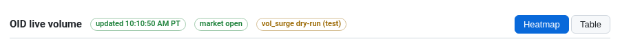
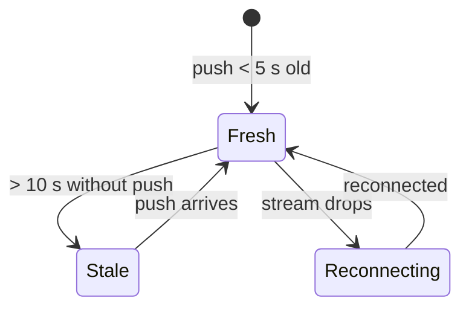

# 1 · Header and status pills
[← Index](README.md)

| Pill | Means | Colors |
|---|---|---|
| **updated 10:10:50 AM PT** | Time of the last data push. If it's more than 5 s behind, it adds "· Ns old". | Green = fresh. Amber = more than 10 s old or a data error (⚠). Red "reconnecting…" = browser lost the stream. |
| **market open / closed** | Regular session (6:30 AM–1:00 PM PT). Shows "(half day)" on early-close days. | Green open, amber closed |
| **vol_surge dry-run (test) / LIVE** | Whether the surge trigger engine is only logging (dry run) or armed live. | Amber = dry run, red = LIVE |
| **Heatmap / Table** | Switches the main view. The page remembers your choice. | Blue = selected |
| **Field Guide** | Opens this guide on the live site (`/guide/`). **Dashboard** tab there brings you back. | — |

The page is **light mode only**. Under the strips, the heatmap has a **Group by sector** checkbox, the **Sort** dropdown (default Name A→Z) and a one-paragraph legend covering tile colors, bars, the chips, the wall/flip edge marks and the source tiles.

**Note line** (dashed box below the strips) appears only when something needs explaining:
- *Market closed*: tiles switch to the last full session (close price, day volume vs its 20-day norm). Live 1-minute numbers come back at 6:30 AM PT.
- *Data error*: shows the error and "showing last good data".

