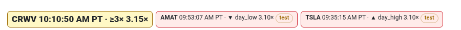
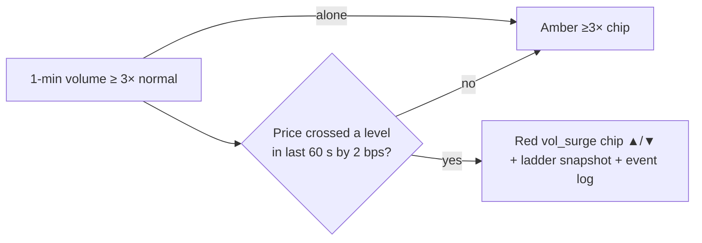

# 2 · Surge strip
[← Index](README.md)

A horizontal row of the most recent volume events, newest first. You can scroll it sideways on a phone.

| Chip | How it looks | What happened |
|---|---|---|
| **≥3× crossing** | amber background — `CRWV 10:10:50 AM PT · ≥3× 3.15×` | 1-minute volume just crossed **3× normal for that minute**. The page records this itself. |
| **vol_surge** | red background — `AMAT 09:53:07 AM PT · ▼ day_low 3.10×` | The trigger engine fired: volume ≥3× **and** price broke a level (day high/low, a FlashAlpha wall/flip, or a seat exit line) within 60 s. ▲ = broke up, ▼ = broke down. |
| **test** pill | amber | Engine is in dry run. The event is logged but nothing is armed. |

**How to read it:** an amber ≥3× chip says *something is busy*. A red vol_surge chip says *busy **and** through a level*, which is the stronger setup.

