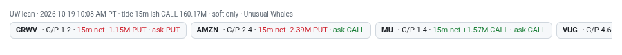

# 3 · Flow lean strip
[← Index](README.md)

This strip shows option money on the names that are **busy right now**: anything pulsing, or any name with 1-minute rvol ≥ 1.5×. It only covers names in the core-20 + focus list that Unusual Whales covers. Hottest names are listed first.

**Legend line (top):** `UW lean · 10:08 AM PT · tide 15m-ish CALL 160.17M`. That's the as-of time of the Unusual Whales files (the desk refreshes them about every 4 minutes; the page re-reads the files every ~45 s), plus the market-wide "tide": net call premium minus net put premium across the market.

Each chip, e.g. `CRWV · C/P 1.2 · 15m net -1.15M PUT · ask PUT`:

| Part | Meaning | See |
|---|---|---|
| C/P 1.2 | Today's call contracts ÷ put contracts | [C/P chip](08-cp-chip.md) |
| 15m net −1.15M PUT | Net call premium minus net put premium over the last 15 min. Under ±$50K counts as FLAT. | [15m lean](09-lean-chip.md) |
| 5m net −0.41M PUT | Same, over the last ~5 min (one UW refresh interval). Under ±$25K counts as FLAT. Left out when there is no fresh 5m value. | [5m lean](20-lean5-chip.md) |
| ask PUT | From flow alerts: was more premium **paid at the ask** (aggressive buying) in calls or in puts? | below |
| hot | The name is pulsing (≥3× or a recent vol_surge) | [Pulsing](11-hot-vs.md) |

**ask lean** is the "who's paying up" check. Premium traded at the ask usually means buyers are crossing the spread to get in.

### Examples from today (10:10 AM PT)
- **CRWV**: 15m PUT, ask PUT, and rvol about 3×. Every piece agrees: heavy volume with put buyers paying up.
- **AMZN**: 15m PUT but ask CALL. Mixed: net premium went to puts (possibly hedges on a +5% day) while aggressive buyers were still in calls.
- **MU**: 15m CALL, ask CALL. Agreeing call lean.

Colors: green = CALL, red = PUT, amber = FLAT. **This is soft color only. It never elevates a trade by itself.**

This strip is the *slow* option-money read (UW data is typically 3–7 minutes old). For the live read, about 1 s behind the tape, look at the [15s / 1m C/P chips](21-live-aggressor-chips.md) on each tile.
