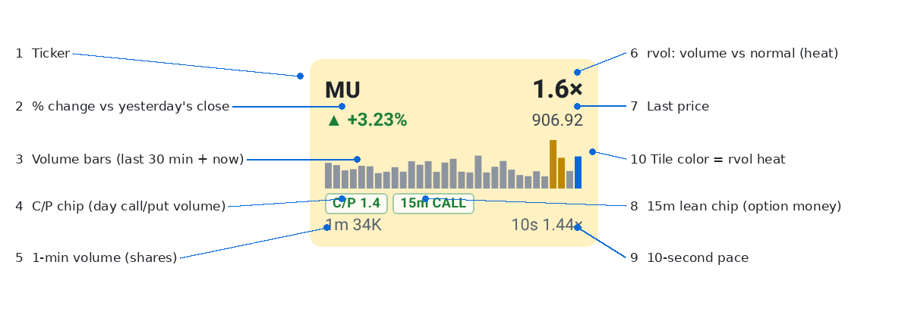
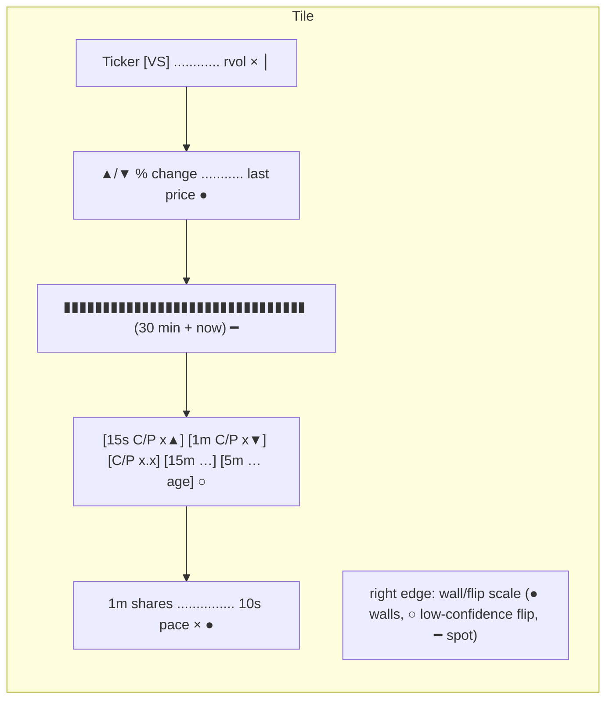

# 4 · Heatmap tile anatomy
[← Index](README.md)

> Changed **Tue 10/20/2026, 7:45 PM PT**: the Heatmap now also shows the **144 sector names** as tiles, one section per sector (16), after the core groups. Same tile, same colors and pulse; differences are listed under [Sector-name tiles](#sector-name-tiles). **Click any group bar to fold it** (remembered on that device). Clicking a tile opens its [chart](30-chart.md).

| # | Field | Page |
|---|---|---|
| 1 | Ticker (+ **VS** tag if a vol_surge fired in the last 5 min), then the score badge: **Direction (core)** ±n on core tiles; **F±n** (Full) and **L±n** (Light) on sector tiles | [11](11-hot-vs.md), [24](24-direction-score.md) |
| 2 | % change vs yesterday's close, with ▲/▼ | [5](05-price-change.md) |
| 3 | Volume bars: last 30 one-minute bars plus the current minute (blue) | [7](07-volume-bars.md) |
| 4 | Chip row, in order: **15s C/P** and **1m C/P** live aggressor chips (with ▲/▼ momentum and coverage %), then the UW **C/P** day volume ratio | [21](21-live-aggressor-chips.md), [8](08-cp-chip.md) |
| 5 | 1-min volume in shares (market closed: day volume) | [10](10-volume-pace.md) |
| 6 | rvol: this minute's volume vs normal for this minute | [6](06-rvol-heat.md) |
| 7 | Last price (market closed: close, marked "cl") | [5](05-price-change.md) |
| 8 | 15m lean chip (*italic* = slow UW data): last 15 min net call−put premium, followed by the **5m chip** (last ~5 min, small grey number = data age) | [9](09-lean-chip.md), [20](20-lean5-chip.md) |
| 9 | 10s pace: last 10 s of volume, scaled to a minute, vs normal | [10](10-volume-pace.md) |
| 10 | Tile background = rvol heat. Red pulsing border = hot. | [6](06-rvol-heat.md), [11](11-hot-vs.md) |
| 11 | **Right-edge scale**: FlashAlpha call wall (green), put wall (red), gamma flip (amber, hollow = low-confidence) and spot (black tick), sized by OI + today's volume. Hover or tap it for prices. | [23](23-wall-marks.md) |

Clicking a tile opens its [chart](30-chart.md) (tapping the right-edge scale opens the wall tooltip instead; clicking a source tile such as VIX switches to the [Table view](13-table.md)).
Tiles sit inside their sector section when **Group by sector** is on (default); see [Sector groups](19-sectors.md).
The 15s/1m chips appear on every optionable streamed name (57 of 61). The UW chips (C/P, 15m, 5m) appear only on core-20 + focus names that Unusual Whales covers. The edge scale appears only on names with FlashAlpha levels (the desk's 20 wall names). Other tiles just leave those parts out.

## Sector-name tiles
The 144 sector names (`wide-sectors.json`) sit in 16 grey sections with a **dashed** left bar, after the core groups and in the file's sector order. Each section header shows: name, count, **avg % change**, **avg rvol**, **N surge** (red) and **N move** (≥3% vs prior close). The tile is the same component as a core tile:

| Part | Core tile | Sector tile |
|---|---|---|
| Background color | 1-min rvol (day rvol when closed): <1.5× grey, 1.5× pale, 2× amber, ≥3× pink | **same thresholds** |
| Red pulsing border | ≥3× rvol or a vol_surge in the last 5 min | ≥3× 1-min rvol (**SURGE**) |
| % change, last price ("cl" when closed) | yes | yes |
| Volume bars | last 30 one-min bars + current minute (blue), red ≥3× norm, amber ≥1.5× | **same**: from the sector bar store + bars the page sees close during the day, norms from the sector norm file. After a page-server restart mid-session the bars refill minute by minute |
| Score badge | **Direction (core)** ±n | **F±n** = Full (sector), **L±n** = Light; **F— / L—** = no value now (after hours, or the score feed has none) |
| Momentum row | ACCEL / RESUME / DECEL / quiet + ¼ / $1 distances, news badge | **mom —** (the momentum engine covers core names only); a CALL/PUT/FLAT flow-lean chip when there is one |
| C/P chips | 15s / 1m quote-rule aggressor chips + UW C/P, 15m, 5m | 15s / 1m **tick-test** chips marked **tt**; **C/P 15s — · 1m —** when no option prints. No UW chips |
| Bottom row | 1-min shares + volume arrow · 10s pace (closed: day shares · vs norm) | **same** (from the same sector feed read; no extra data pulls) |
| Right-edge wall scale | FlashAlpha walls (~10 min refresh) | only for names pulled after a surge (≤30 a day); hover shows the prices |

**—** always means "no data for this name now", never zero. The Sort dropdown orders sector tiles the same way as core tiles, inside each section (or all 205 names together when Group by sector is off).

Performance (headless test, 10/20 7:45 PM PT, 209 tiles): one full heatmap refresh takes ~5 ms (~10 ms if every tile changes); page main thread ~4% busy at the 1 s refresh (core only: ~3%). Sector tiles only redraw when their numbers change, folded sections are not drawn, and sector sparklines load every 15 s (2 min when closed) from `/wide-spark.json`.

**Source tiles** (VIX, IWM, WTI, Brent) look different: a big value, % change, unit, the source line and an "updated Ns ago" / **CLOSED** / **STALE** stamp, with no bars, chips or edge scale. See [Sector groups & source tiles](19-sectors.md).

