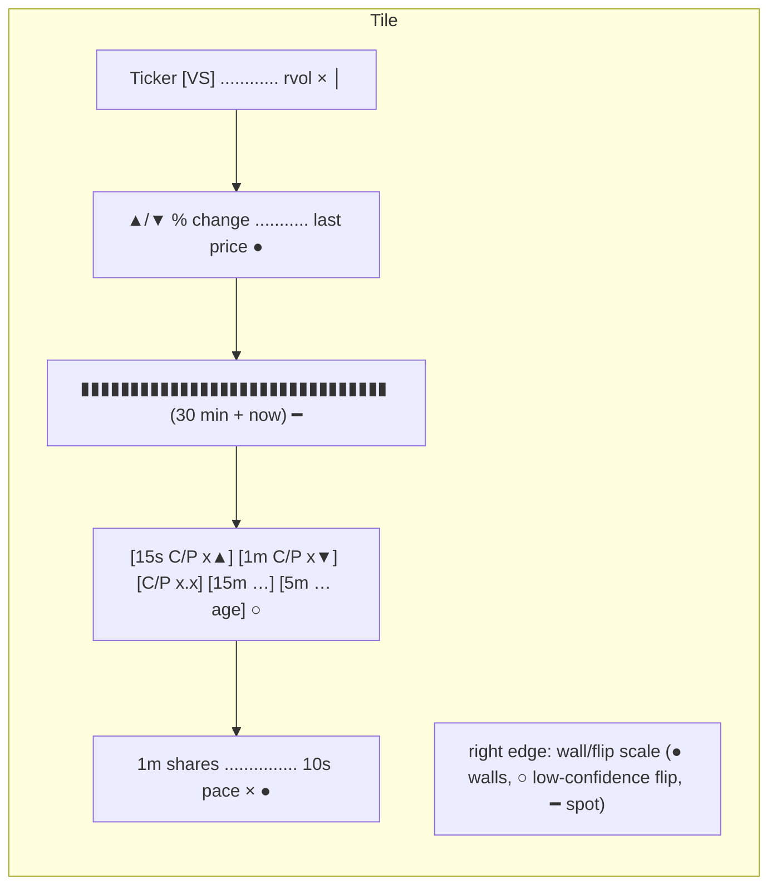

# 4 · Heatmap tile anatomy
[← Index](README.md)

| # | Field | Page |
|---|---|---|
| 1 | Ticker (+ **VS** tag if a vol_surge fired in the last 5 min) | [11](11-hot-vs.md) |
| 2 | % change vs yesterday's close, with ▲/▼ | [5](05-price-change.md) |
| 3 | Volume bars: last 30 one-minute bars plus the current minute (blue) | [7](07-volume-bars.md) |
| 4 | Chip row, in order: **15s C/P** and **1m C/P** live aggressor chips (with ▲/▼ momentum and coverage %), then the UW **C/P** day volume ratio | [21](21-live-aggressor-chips.md), [8](08-cp-chip.md) |
| 5 | 1-min volume in shares (market closed: day volume) | [10](10-volume-pace.md) |
| 6 | rvol: this minute's volume vs normal for this minute | [6](06-rvol-heat.md) |
| 7 | Last price (market closed: close, marked "cl") | [5](05-price-change.md) |
| 8 | 15m lean chip (*italic* = slow UW data): last 15 min net call−put premium, followed by the **5m chip** (last ~5 min, small grey number = data age) | [9](09-lean-chip.md), [20](20-lean5-chip.md) |
| 9 | 10s pace: last 10 s of volume, scaled to a minute, vs normal | [10](10-volume-pace.md) |
| 10 | Tile background = rvol heat. Red pulsing border = hot. | [6](06-rvol-heat.md), [11](11-hot-vs.md) |
| 11 | **Right-edge scale**: FlashAlpha call wall (green), put wall (red), gamma flip (amber, hollow = low-confidence) and spot (black tick), sized by OI + today's volume. Hover or tap it for prices. | [23](23-wall-marks.md) |

Clicking a tile switches to the [Table view](13-table.md) sorted by rvol (tapping the right-edge scale opens the wall tooltip instead).
Tiles sit inside their sector section when **Group by sector** is on (default); see [Sector groups](19-sectors.md).
The 15s/1m chips appear on every optionable streamed name (57 of 61). The UW chips (C/P, 15m, 5m) appear only on core-20 + focus names that Unusual Whales covers. The edge scale appears only on names with FlashAlpha levels (the desk's 20 wall names). Other tiles just leave those parts out.

**Source tiles** (VIX, IWM, WTI, Brent) look different: a big value, % change, unit, the source line and an "updated Ns ago" / **CLOSED** / **STALE** stamp, with no bars, chips or edge scale. See [Sector groups & source tiles](19-sectors.md).

