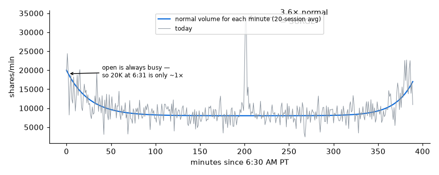
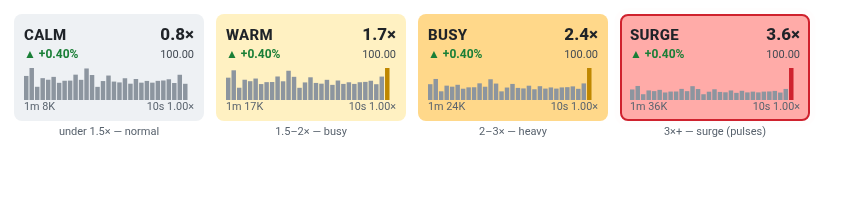
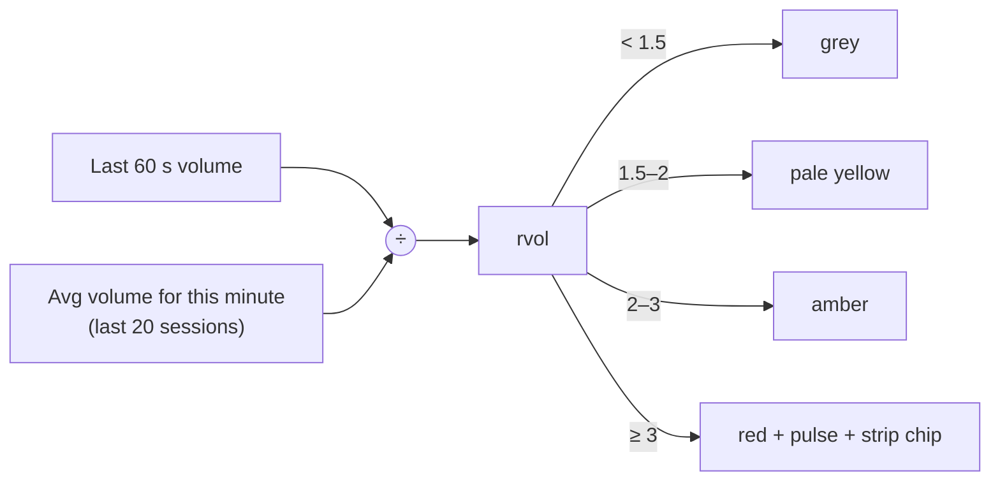

# 6 · rvol and heat color
[← Index](README.md)

**rvol (relative volume)** = shares traded in the last 60 s ÷ the average for **that same minute of the day** over the last 20 sessions.

Comparing against the same minute is what makes it useful. The open and the close are always busy, so 20K shares at 6:31 AM might be ordinary while 20K at 10:15 AM is huge.

### Heat colors (tile background)

| rvol | Tile color | Table label | Plain English |
|---|---|---|---|
| under 0.7× | light grey | LIGHT | Quieter than usual |
| 0.7–1.5× | light grey | INLINE | Normal |
| 1.5–2× | pale yellow | HEAVY | Busy |
| 2–3× | amber | HEAVY | Very busy |
| **3×+** | **pink/red + pulsing border** | **SURGE** | Unusual. Feeds the surge strip. |

After hours the tile uses **day volume ÷ 20-day average day volume** for its color instead.

