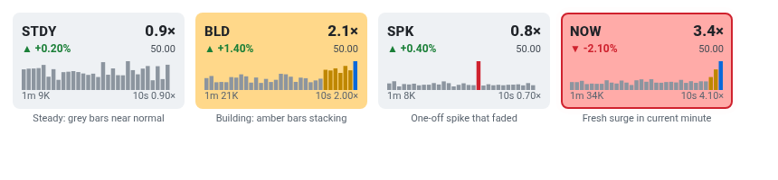

# 7 · Volume bars (sparkline)
[← Index](README.md)

Each tile shows the last **30 one-minute volume bars**, plus a **blue bar for the minute in progress**. Each bar is colored by how it compared with normal for its own minute:

| Bar color | Meaning |
|---|---|
| grey | Under 1.5× normal |
| amber | 1.5–3× normal |
| red | 3×+ normal |
| blue (last bar) | Current minute so far. It's compared against a pro-rated norm, so 30 s in is measured against half a minute's normal. |

**Patterns to recognise**
- **Steady**: all grey, nothing to see.
- **Building**: amber bars stacking up over several minutes. Interest is growing, and this often comes before a level break.
- **One-off spike that faded**: a single tall bar followed by grey. A block or news blip that didn't follow through.
- **Fresh surge**: red or amber in the last bars and a tall blue current bar. This is the one that matters right now.

Bars are scaled per tile (the tallest bar fills the height), so compare **colors** across tiles, not heights.
