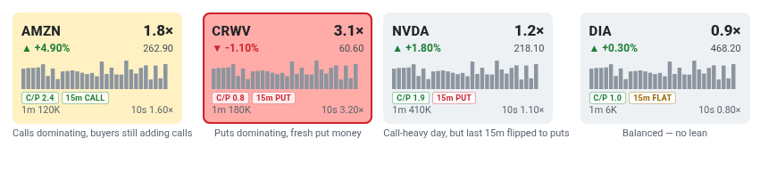

# 8 · C/P chip (call/put volume ratio)
[← Index](README.md)

`C/P 2.4` = today's **option call contracts ÷ put contracts** traded on that ticker (source: Unusual Whales).

| Value | Chip color | Read |
|---|---|---|
| ≥ 1.0 | green | More calls than puts traded today |
| < 1.0 | red | More puts than calls |

Rough guide: most large stocks trade more calls than puts on a normal day, so a ratio around **1–2 is ordinary**. Ratios **above 3** are call-heavy, and **under 0.7** is put-heavy.

**Not the same as the 15s / 1m C/P chips.** Those are live *premium paid by aggressive buyers* (calls ÷ puts) from the OPRA tape, ~1 s behind; this one is the whole day's *contract volume*, from UW. See [21](21-live-aggressor-chips.md).

**Limits:** this counts contracts, not dollars, and it doesn't know whether they were bought or sold. A big put *seller* still adds to put volume. Use the [15m lean](09-lean-chip.md) and *ask lean* for direction.

