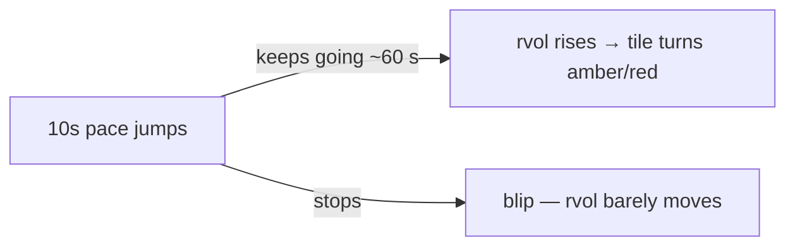

# 10 · 1-min volume and 10s pace
[← Index](README.md)

Bottom row of a tile:

- **`1m 34K`**: shares traded in the last 60 seconds (rolling). After hours it shows `day 52.1M` instead.
- **`10s 1.44×`**: the last **10 seconds** of volume, scaled up to a minute and compared with normal. It's an early-warning number.

| rvol (60 s) | 10s pace | Read |
|---|---|---|
| 1.2× | **4.0×** | Something just started. rvol will climb over the next minute if it keeps going. |
| 3.5× | 3.8× | Surge still running |
| 3.5× | **0.6×** | Surge already cooling. The 60 s window still holds the burst. |

