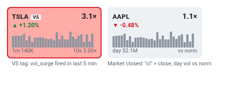

# 11 · Pulsing border and VS tag
[← Index](README.md)

| Marker | Turns on when | Turns off |
|---|---|---|
| **Pulsing red border** ("hot") | rvol ≥ 3× **or** a vol_surge fired on the name in the last 5 min | Both conditions clear |
| **VS** tag next to ticker | A vol_surge event (volume ≥3× plus a level break) in the last 5 min | 5 min after the event |

Hot names also get a pink row in the [Table](13-table.md) and go first in the [flow lean strip](03-flow-lean-strip.md). They sort to the top when Sort = *Surges first*.

**Read:** pulsing without VS = heavy volume but no level broken (yet). Pulsing **with VS** = volume and a break, so check the [ladder](14-ladder.md) for that name.
