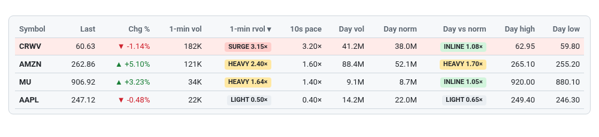

# 13 · Table view
[← Index](README.md)

Click any column header to sort. Click it again to reverse the order (▾/▴).

| Column | Meaning |
|---|---|
| Symbol | Ticker |
| Group | Sector group from `sectors.json` ([19](19-sectors.md)). With Group by sector on, rows are grouped under a summary row and your column sort applies inside each group. |
| Last | Latest trade price |
| Chg % | vs yesterday's close |
| 1-min vol | Shares in the last 60 s |
| 1-min rvol | Label + ratio: LIGHT < 0.7×, INLINE 0.7–1.5×, HEAVY 1.5–3×, **SURGE ≥ 3×** |
| 10s pace | Last 10 s, scaled to a minute, vs normal |
| Day vol | Shares traded so far today |
| Day norm | Typical volume **by this time of day** (20-session avg) |
| Day vs norm | Day vol ÷ day norm, with the same labels |
| Day high / Day low | Regular-session range. vol_surge breaks are often of these. |
| Last trade | Time of the latest print (PT) |

Hot rows (≥3× or recent vol_surge) are shaded pink.

The table has no chip or wall columns; switch back to the Heatmap for the 15s/1m chips and the [wall/flip marks](23-wall-marks.md).
