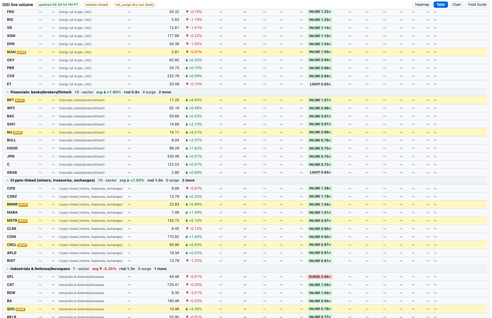

# 13 · Table view (one table for every ticker)
[← Index](README.md)

> Changed **Tue 10/20/2026, 6:30 PM PT**: the 144 **Sector watch** names are now sections of this table (one per sector, after the core groups). The separate Sector watch panel is now a one-line bar with its alerts and an **Open in Table ▸** button. The Heatmap is unchanged (core tiles).

Click a column header to sort, click again to reverse (▾/▴). With **Group by sector** on, rows sit under a group bar and your sort applies inside each group. **Click a group bar to fold or unfold it** (remembered). Click a row to open its [chart](30-chart.md). Core groups come first (`sectors.json`), then the 16 sectors (`wide-sectors.json`).

## Columns (same set for every ticker)

**—** means that ticker has no data for that column. It is shown on purpose so you can see the gaps. **tt** (purple) marks a number built from the **tick-test** C/P (sector names). **F±n** is the sector names' full-profile score. Hover a column header for its definition.

| Column | Meaning |
|---|---|
| Symbol | Ticker, with a red **SURGE** tag (sector rows) or amber **MOVE** tag (≥3% vs prior close, sector rows) |
| Score | Direction score −3…+3, raw. Core names: core profile. Sector names: **F±n** = full profile ([24](24-direction-score.md)) |
| Light | LIGHT score (trend + volume + market only). Sector names only |
| Group | Core group or sector |
| Momentum | ACCEL / RESUME / DECEL / quiet chip with ¼ and $1 distances ([25](25-momentum.md)). Core names only |
| Last, Chg % | Latest trade (or last-session close when the market is shut), % vs prior close |
| 1-min vol | Shares in the last 60 s |
| 1-min rvol | LIGHT < 0.7×, INLINE 0.7–1.5×, HEAVY 1.5–3×, **SURGE ≥ 3×**. Same labels and thresholds for every ticker |
| 10s pace | Last 10 s scaled to a minute, vs normal |
| Day vol / Day norm | Shares so far today / typical by this time of day |
| Day vs norm | Day vol ÷ norm, same labels |
| Day high / Day low | Regular-session range |
| C/P 15s / C/P 1m | Aggressor call/put premium ratio with its direction arrow ([21](21-live-aggressor-chips.md)). Core = quote rule; sector = **tt** tick test |
| Lean | CALL if the 1-min C/P (else 15 s) is above 1.10, PUT below 0.91, else FLAT; thin windows give none. Same rule for all |
| Vol dir | Last 15 s of volume vs the prior 60 s (regular hours) |
| Walls | Call wall / put wall / flip with % from last (FlashAlpha) |
| Last trade | Time of the latest print (PT) |

Hot rows (1-min rvol ≥ 3×, or a recent vol_surge on core names) **pulse pink** for every ticker, the same way a hot tile pulses. MOVE rows (sector) are pale yellow.

## Gap audit (10/20/2026, 6:30 PM PT)

Ticker sets: **core** = 65 rows (61 streamed stocks/ETFs plus 4 extended rows such as VIX and the WTI / Brent futures, which only have Last and Chg %). **Sector** = 144 Sector watch names in 16 sectors. Counts are from the live page at 6:30 PM PT (market closed).

| Column | Core | Sector | Same method? |
|---|---|---|---|
| Score | yes (61) | yes, **full profile F±n** (regular hours; — after hours) | **Differs:** sector full profile uses the tick-test C/P at half weight, and flip/walls only for names pulled on a surge |
| Light | **missing** (no light profile runs on core) | yes (regular hours) | sector only |
| Group | yes | yes | core groups vs sector list |
| Momentum | yes (57 names the engine tracks) | **missing** (engine is core only) | core only |
| Last, Chg % | yes | yes | same |
| 1-min vol | yes | **missing** (sector feed sends rvol, not the share count) | core only |
| 1-min rvol | yes | yes (regular hours) | same labels and thresholds; sector norms come from the sector bar store |
| 10s pace | yes | **missing** | core only |
| Day vol, Day norm | yes | **missing** | core only |
| Day vs norm | yes | yes (144) | same ratio; sector value comes from the sector feed |
| Day high / low | yes | **missing** | core only |
| C/P 15s / 1m | yes, names in the core options set | yes, about 140 names (2,972 contracts) | **Differs:** core = quote rule vs OPRA NBBO; sector = **tick test** (no streamed option quotes: the 1,000-quote cap per connection is used by the core). Marked **tt** |
| Lean | yes (computed in the page from the C/P, new 10/20) | yes (server) | same rule (1.10 / 0.91); sector built on the tick-test C/P (**tt**) |
| Vol dir | yes | yes | same rule, regular hours |
| Walls | yes (58; FlashAlpha refresh ~10 min) | **mostly missing**: only after a surge (≤30 pulls a day) | same source, very different freshness |
| Last trade | yes | **missing** | core only |

Not in the table for either set (Heatmap tiles only, core names): the UW 15m / 5m lean chips, the news badge and the sparkline.

Filling the sector gaps would need the sector feed to send share counts, highs/lows and pace (a collector change), a momentum engine run on the sector names, and more FlashAlpha pulls. None of that is switched on: collector caps and data subscriptions are unchanged.
