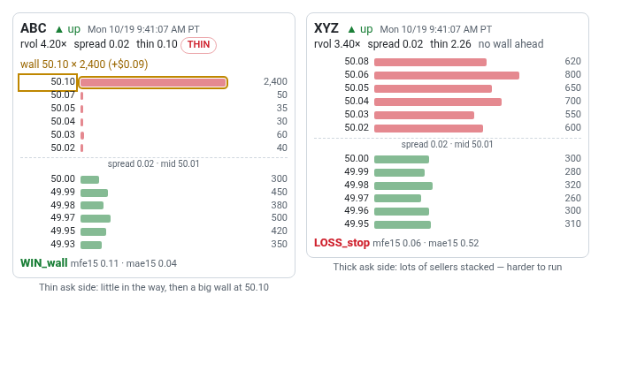
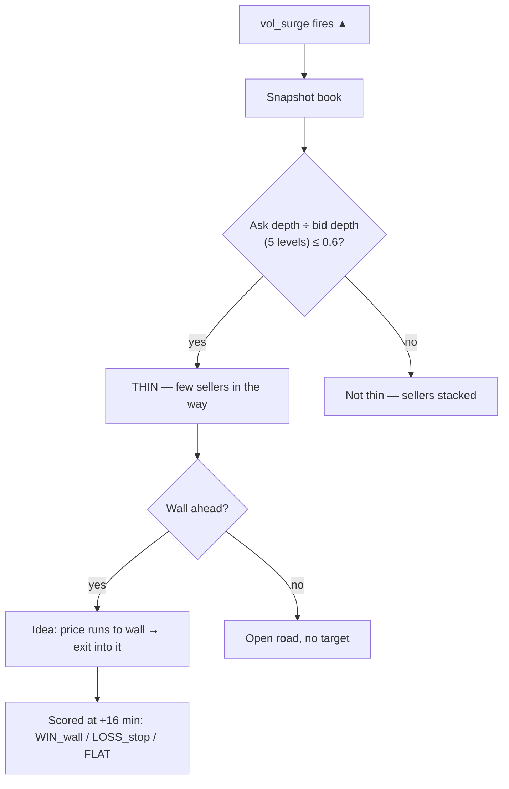

# 14 · Last ladder panel
[← Index](README.md)

> **Retired: the Last ladder panel is no longer on the live page** (checked Tue 10/20/2026, 6:55 PM PT). This page is kept for reference only. The ladder dry run itself is listed on the [Research tab](32-research-tab.md).

The **Last ladder** panel spans the full page width right under the tile grid, newest card per symbol first (up to 10). Each time a vol_surge fires, the box takes a **snapshot of the Robinhood order book** for that stock and posts it here. This is a *dry run* that tests one idea: **when the book is thin in the direction price is moving, does price run to the next big resting order (the "wall")?**

### Card fields
| Field | Meaning |
|---|---|
| **▲ up / ▼ down** | Direction of the surge break |
| **rvol** | 1-min rvol when it fired |
| **spread** | Ask − bid |
| **thin 0.16** | Depth of the first 5 levels on the side price is moving **into**, divided by the depth on the other side. **≤ 0.6 gets a red THIN badge.** |
| **wall 50.10 × 2,400 (+$0.09)** | First level ahead with ≥3× the median size of the first 10 levels (and ≥500 shares). Distance from mid is in brackets. The wall row is outlined in gold. |
| Red bars (top) | Asks, sellers. Price going **up** has to eat through these. |
| Green bars (bottom) | Bids, buyers. Price going **down** eats these. |
| **[TEST]** / dashed border | Test payload, left out of stats |
| **Outcome** (after 16 min) | **WIN_wall**: reached the wall before a $0.50 adverse move. **LOSS_stop**: hit −$0.50 first. **AMBIG_same_bar**: both in the same minute. **FLAT**: neither. `mfe15`/`mae15` = best and worst $ move in 15 min. |

**Example (left card):** ABC surges up at 4.2× rvol. Only about 215 shares sit on the first 5 asks against about 2,050 on the bids (thin 0.10). There's a 2,400-share wall at 50.10, nine cents above mid. It reached the wall: WIN_wall.
**Example (right card):** XYZ surges up, but 3,300 shares are stacked on the first 5 asks against about 1,460 on the bids (thin 2.26) and there's no wall. It stalled and hit the stop: LOSS_stop.

*Robinhood shows one snapshot, not live ticks, and walls can be pulled or hidden. That's why this stays a research dry run.*
