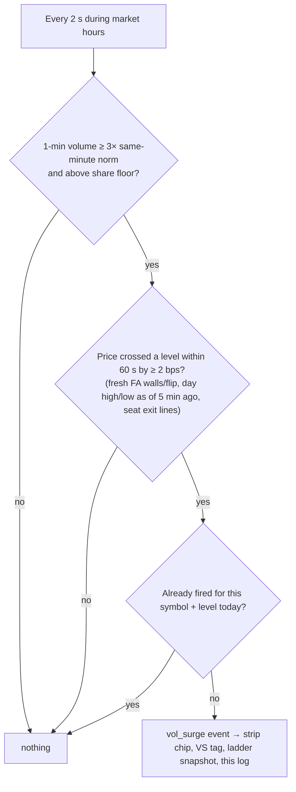

# 17 · vol_surge events log
[← Index](README.md)

The full list of trigger-engine surge events today, newest first. It sits in the collapsed **Logs** section at the bottom of the page (click **Logs** to open it). Example:

`09:53:07 AM PT  AMAT ▼ day_low 420.14 · last 419.90 · rvol 3.10× · 60s 20K  [test]`

| Part | Meaning |
|---|---|
| ▼ day_low 420.14 | Direction and the level that broke (day_high, day_low, a FlashAlpha wall or flip, or a seat exit line) at that price |
| last | Price when it fired |
| rvol / 60s | 1-min rvol and shares in the last 60 s |
| seat | Linked trader seat, if any |
| test / LIVE | Dry run vs armed |

The header shows the engine gate status and its last update time.

### When it fires

Skipped during the first 2 minutes, on half days, and when data is lagging more than 5 s.
