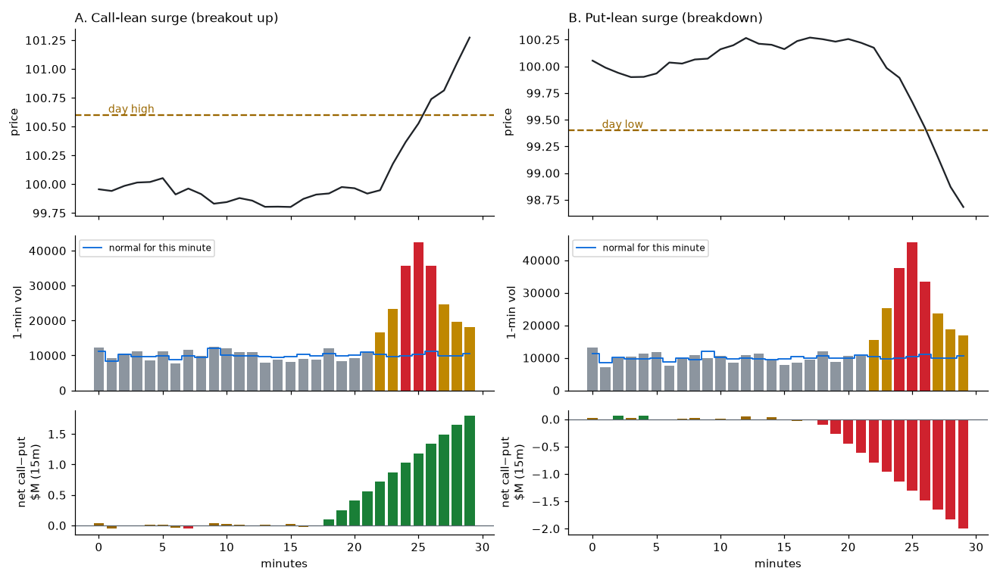
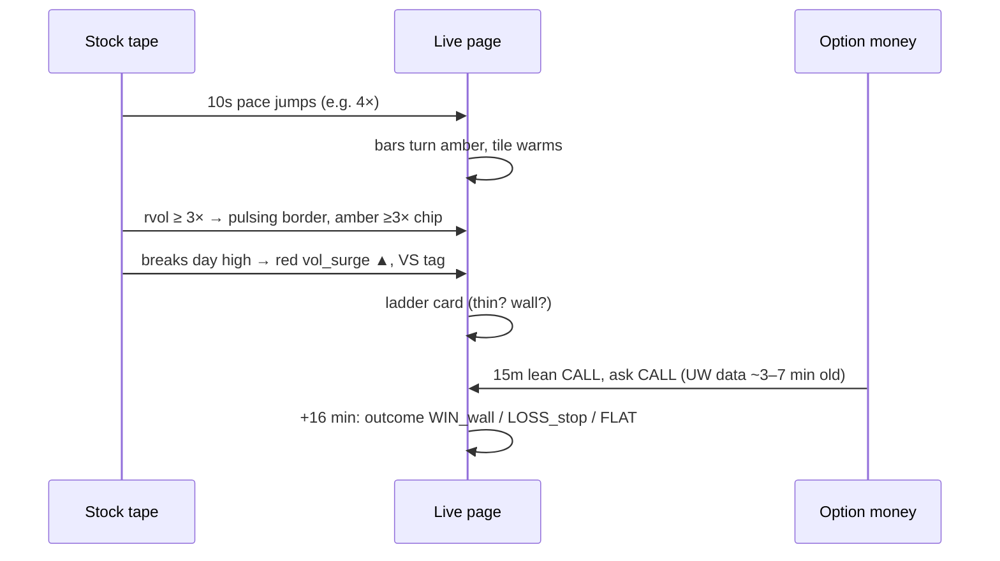
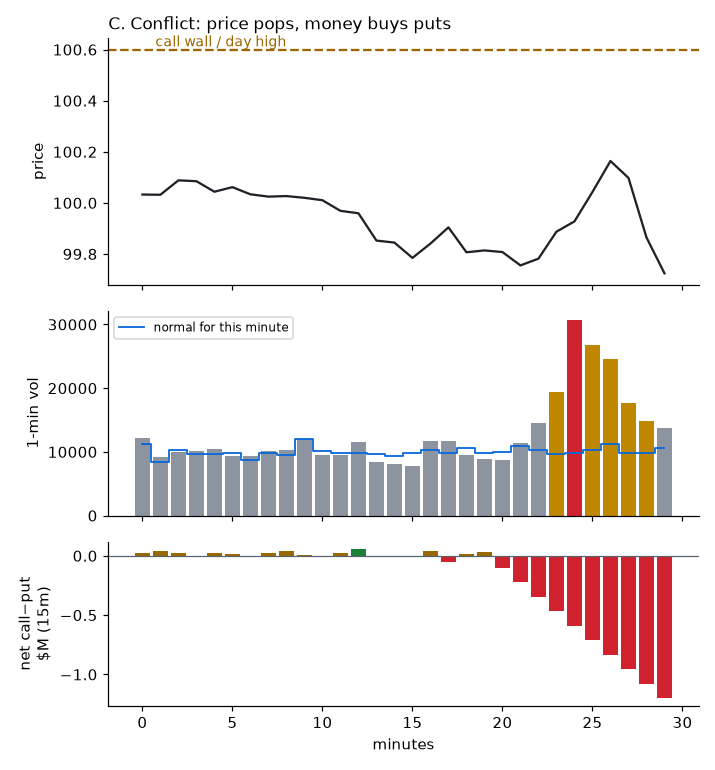
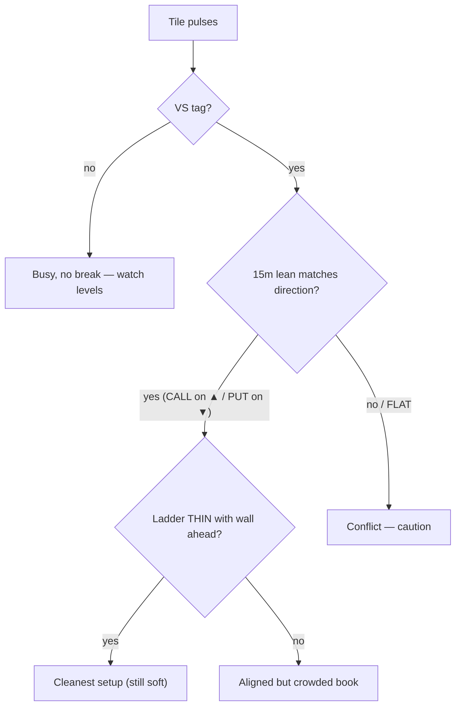

# ★ Signal walkthroughs
[← Index](README.md)

*Charts are illustrative and not from a real trade. The tile and chip images use the live page's styling.*

## A vs B: call-lean surge vs put-lean surge

| What you see on the page | A: Call-lean surge (up) | B: Put-lean surge (down) |
|---|---|---|
| Volume bars | Amber, then red bars stacking, with a tall blue current bar | Same |
| Tile color / border | Amber → red, pulsing | Amber → red, pulsing |
| % change | Green ▲ and growing | Red ▼ and growing |
| Surge strip | Red `▲ day_high 3.6×` | Red `▼ day_low 3.8×` |
| VS tag | Yes | Yes |
| 15m lean chip | **15m CALL** (green), net climbing, e.g. +1.8M | **15m PUT** (red), e.g. −2.0M |
| ask lean (flow strip) | **ask CALL**: buyers paying up for calls | **ask PUT** |
| Ladder | Ideally **THIN** on the ask side, with a wall above | Ideally **THIN** on the bid side, with a wall below |

**Reads as:** price, volume and option money all point the same way. This is the cleanest version of the setup. It's still soft context: the traders' own rules (chase limits, walls, stops) decide whether anything happens.

## C: Conflict (price up, money buying puts)

Volume pops and price pushes into a call wall or day high, but the **15m lean is PUT** and the flow strip may show `ask PUT`. Two common reasons:
1. People are **hedging** a winning position (puts bought into strength). AMZN on 10/19 was like this: +5% on the day, 15m net put, but ask lean still CALL.
2. Smart money is fading the pop.

**Reads as:** caution, and no follow-through is confirmed. Watch whether price holds the level once the bars go back to grey.

## D: Busy but no break
Tile is amber or red and pulsing, **no VS tag**, and % change is small. Volume is heavy without a level break. That's often a pin near a wall (example 10/19: AMD boxed between 540 and 550 on a busy tape). Watch for the break, and don't treat it as a signal yet.

## E: Spike that fades
One red bar in the sparkline, then grey, with 10s pace back under 1×. A block print or headline blip. Ignore it unless it repeats.

## F: Pressing a wall (use the edge marks)
The black spot tick sits right on a big green call-wall dot (or a big red put-wall dot), and the [15s/1m chips](21-live-aggressor-chips.md) are amber or fading. That's a pin, not a breakout (10/19 example: SPY closing between its 767 put wall and 768 call wall). A real break shows the tick moving *through* the dot on rising rvol, with the 1m chip green ▲ (calls) or red ▼ (puts). Hover the scale to see how far away the next level is. If the only nearby level is a **hollow** flip, treat it as approximate. See [23](23-wall-marks.md).

## Quick checklist when something pulses

