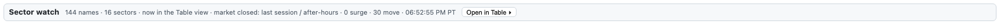
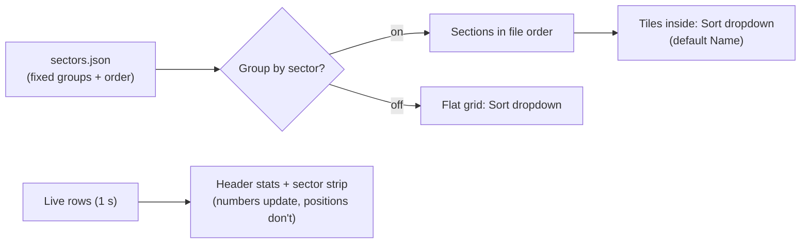
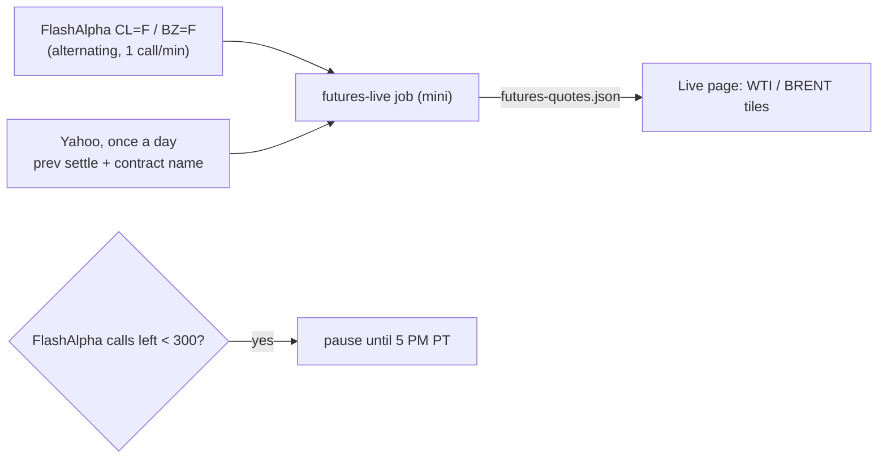

# 19 · Sector groups and source tiles (heatmap, table, sector strip, VIX / IWM / WTI / Brent)
[← Index](README.md)

Tiles are grouped into sectors so rotation is easy to spot: for example semis hot and green while neoclouds sit grey and red.

## Where it shows up
| Place | What you see |
|---|---|
| **Sector strip** (under the flow lean strip) | One chip per group: short name, average % change, average rvol (chip color = the same heat scale as tiles), and 🔥 count of hot tiles. Tap a chip to jump to that group. |
| **Heatmap → Group by sector** (checkbox, **on by default**) | One section per group. Each section header shows the group summary (below). Tiles inside are ordered by the **Sort** dropdown (default Name A→Z). Untick to get the flat grid back. The page remembers the choice on that device. |
| **Heatmap → sector sections** (since 10/20 7:45 PM PT) | After the core groups, one section per sector (16, from `wide-sectors.json`) with the 144 sector names as tiles. Grey card, dashed bar; header = count, avg % change, avg rvol, N surge, N move. **Click any group bar (core or sector) to fold it**; the page remembers folds on that device. See [4 · Sector-name tiles](04-tile-anatomy.md#sector-name-tiles). |
| **Table view** | New **Group** column. With Group by sector on, rows are grouped with a summary row per group; the column you click sorts rows *inside* each group. |
| **Sector watch bar** (under the heatmap/table) | One line: "Sector watch", the sector feed status and its batched alerts, and **Open in Table ▸**, which jumps to the 144 sector names in the Table. The old Sector watch grid is **retired** (since 10/20 6:30 PM PT); its rows now live in the Table ([13](13-table.md)).  |
| **Tile tooltip** | Hover or long-press a tile to see its group name. (The right-edge wall scale has its own tooltip, see [23](23-wall-marks.md).) |

## Group header, field by field
```
Semiconductors  14   avg ▲ +2.31%   rvol 1.4×   3 hot   15m net +1.20M   5m net −0.08M
└ name          └ tiles └ mean % chg   └ mean rvol  └ pulsing  └ Σ 15m UW net  └ Σ 5m UW net
```
| Field | Meaning |
|---|---|
| count | Tiles in the group right now |
| avg % change | Plain mean of each tile's % change vs yesterday's close (an ETF counts as one tile) |
| rvol | Mean of the tiles' rvol (1-min live, day rvol when closed). The header's left border uses the heat color. |
| N hot | Tiles pulsing (≥3× rvol or a vol_surge in the last 5 min) |
| 15m net | Sum of the [15m lean](09-lean-chip.md) net premium across the group's UW-covered names. Green > +$50K, red < −$50K, amber in between. Shown only if at least one name is UW-covered. |
| 5m net | Same, using the [5m lean chip](20-lean5-chip.md) (±$25K band). Only names with a fresh 5m value are summed. |

## Tiles never jump between groups
Group membership comes from a config file, not from live data, so a tile always stays in the same section. The **section order is fixed** too (the order in the file). Only the Sort dropdown reorders tiles, and only inside their group. With the default **Name** sort nothing moves at all.



## Reading rotation: examples
| Strip looks like | Read |
|---|---|
| `Semis +2.4% · 1.8×` `Memory +3.1% · 2.2× · 2🔥` `Neoclouds −0.6% · 0.9×` | Money rotating into chips/memory and out of the debt-funded builders |
| Every chip amber/red heat, all green % | Broad, heavy risk-on tape (index-led) |
| Index chips grey, one group red heat | Sector-specific news; check X Summarizer/Research for the headline |
| Group 15m net green but 5m net red | Call money earlier, last few minutes flipped to puts: early fade warning (soft) |

## Current mapping (edit `sectors.json`)
| Group | Tickers |
|---|---|
| Major indices | SPY, QQQ, DIA, IWM\*, RSP, TQQQ, VTV, VUG, EWY |
| VIX | VIX\* |
| WTI crude | WTI\* (CME CL front-month future) |
| Brent crude | BRENT\* (CME BZ front-month future) |
| Hyperscalers / megacap | MSFT, GOOGL, GOOG, AMZN, META, AAPL, ORCL |
| Neoclouds / AI infra | CRWV, NBIS, IREN, WULF, CBRS, SMCI, DELL |
| Semiconductors | NVDA, AMD, AVGO, MRVL, INTC, TSM, ARM, QCOM, ALAB, ADI, TXN, ON, SMH, SOXX |
| Semi equipment | ASML, AMAT, LRCX, KLAC |
| Memory / storage | MU, SKHY, SNDK, WDC, STX, DRAM |
| Networking / optics | ANET, CRDO, LITE, COHR, AAOI, GLW, KEYS |
| Enterprise software | PLTR, INTU |
| Power / energy | BE, VRT |
| Consumer / other | TSLA, NFLX, SPCX |
| Other (anything not listed) | MH |

\* Not on the Alpaca SIP stock stream. These **source tiles** come from desk files on the mini and have no volume bars, rvol or lean chips:

| Tile | Source | Typical freshness | Stamp |
|---|---|---|---|
| VIX | `vix-live.json`: FlashAlpha real-time index quote | ~1–2 min | "updated Ns ago" |
| IWM | `rh-quotes.json`: Alpaca SIP snapshot written by the mini marks job (the file name is historical; it is not a Robinhood quote) | ~60 s | "updated Ns ago" |
| WTI | `futures-quotes.json`: **real NYMEX CL front-month future** from FlashAlpha (`CL=F`, CME Globex feed), written by the mini job `futures-live` | ~2 min (each symbol polled every ~2 min, 6:30 AM–1:00 PM PT weekdays (RTH); every 30 min in other CME hours) | label **WTI CL front · Dec '26**; "updated Ns ago" |
| BRENT | `futures-quotes.json`: **real CME BZ front-month future** (Brent Last Day Financial, cash-settled against ICE Brent) from FlashAlpha (`BZ=F`) | ~2 min (same schedule) | label **Brent BZ front · Dec '26**; "updated Ns ago" |

The old USO (WTI) and BNO (Brent) ETF proxy tiles were removed on 10/19 at 12:16 PM PT when the real futures went live. There are no proxy labels any more.

**Known gap:** CME holidays aren't in the calendar yet, so on a CME holiday the futures tiles will say **STALE** instead of **CLOSED**.

### WTI / Brent futures tiles, field by field
| Part | Meaning |
|---|---|
| Big number | Last price of the front-month future, $/bbl |
| % change | vs the **previous settle** (Yahoo's prior-session close, read once per CME trading day). If it isn't available yet the tile shows `—` and the note says "no prev settle yet" |
| Label `WTI CL front · Dec '26` | The contract the price belongs to. Hover for the contract code (e.g. `CLZ26`) |
| **CLOSED** (grey tag) | CME energy is shut: the daily break **2–3 PM PT Mon–Thu**, or the weekend (**Fri 2 PM → Sun 3 PM PT**). The last price stays with its "as of" time; this is not an error |
| **STALE** (amber) | Market open but the price is older than 10 min (30-min schedule: 40 min). Usually a FlashAlpha outage or the quota guard |
| **DELAYED** in the note | FlashAlpha was unavailable, so the price is Yahoo's ~10-min-delayed quote (source line says Yahoo) |

**Contract roll.** The front month is the first contract with more than one business day before its last trade (CL: 3 business days before the 25th of the prior month; BZ: last business day two months before). Example: CL Nov '26 stops trading Oct 20, so from Oct 19 the tile reads Dec '26; BZ Dec '26 stops Oct 30, so it rolls to Jan '27 on Oct 29. Once a day the job checks Yahoo's contract name for CL; if it differs from the calendar, Yahoo's month is used and the tooltip says so. If FlashAlpha and Yahoo prices are more than 2% apart, the tooltip warns to check the contract.

**Quota guard.** FlashAlpha allows 2,500 calls a day (resets 5 PM PT) shared with VIX and the wall jobs. The futures job makes at most one call a minute in RTH (~390 a day, plus ~4 an hour in other CME hours) and **pauses** if FlashAlpha reports fewer than 300 calls left, so VIX and walls never run dry. Usage is logged in `~/oid-desk/logs/futures-live.log`.



A value is never filled in or estimated: missing → `—`, older than 10 minutes → STALE with its real as-of time. STALE values are left out of the group averages. A group made only of source tiles (VIX, WTI, Brent) shows each tile's value, % change and age (or CLOSED) in its header instead of averages.

## Landscape layout
The page uses the full screen width. Groups sit side by side as cards that wrap to the next row; each card's width comes from its **fixed** ticker count in `sectors.json` (about half its tiles per row), never from live data, so cards don't move. Tiles are compact (about 100 px wide) and the chip row wraps, leaving room for more chips. On a 1920×1080 screen all groups fit above the fold; the ladder, live trades, held options and vol_surge log sit below in two columns. Phones fall back to one group per row, 3 tiles across.

To change a group: edit `~/oid-live-page/sectors.json` on the mini (order of groups = order on the page; keep each ticker in one group), then reload the page. No restart needed; open pages also re-read it every 5 minutes. A new ticker that isn't listed lands in **Other** automatically.
