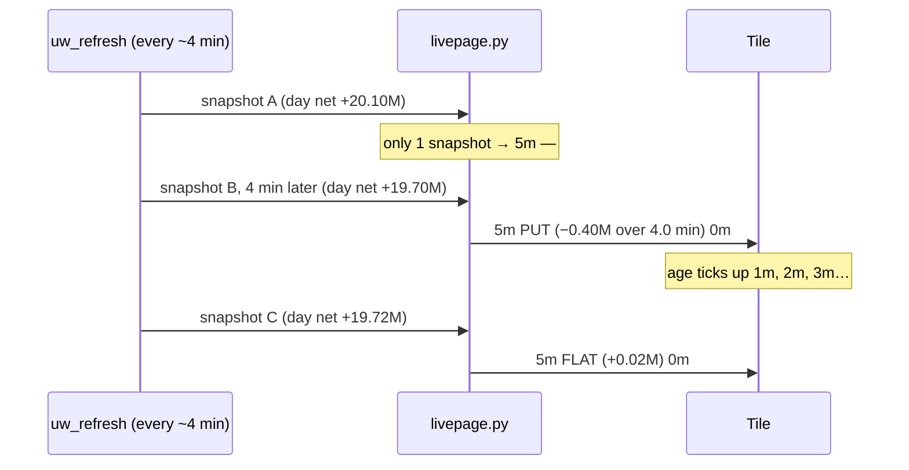

# 20 · 5m lean chip (net premium, last ~5 min)
[← Index](README.md)

`5m CALL` / `5m PUT` / `5m FLAT` / `5m —` sits right after the [15m chip](09-lean-chip.md) on core-20 + focus tiles. Same question, shorter window: **over roughly the last 5 minutes, did more net premium go into calls or puts?**

```
5m net = (UW day net call − net put premium, newest snapshot)
       − (same, snapshot ~5 min earlier)
net > +$25K  → CALL (green)
net < −$25K  → PUT  (red)
otherwise    → FLAT (amber)
```

The small grey number after the word (for example `5m PUT 2m`) is the **age of the UW data** in minutes. Hover/long-press for the dollar figure and the exact window, e.g. *"5m UW net call−put −0.41M over 4.0 min · data 2m old"*.

## Why it's computed this way
Unusual Whales' `uw-net-prem.json` on the mini only has `day`, `last_15m` and `last_30m` totals, with no 5-minute bucket. So `livepage.py` keeps a small rolling history of the day totals (last 12 snapshots, saved to `data/uw-net-hist.json` so a restart doesn't reset it) and subtracts the snapshot closest to 5 minutes old (accepted gap 3–10 min) from the newest one. That difference is exactly the net premium that traded in between.



## Things to know
- **It steps, it doesn't stream.** UW refreshes about every 4 minutes, so the chip changes roughly once per refresh and the window is really "the last UW interval" (usually 4 min, sometimes up to 10).
- **`5m —` means no guess.** Shown when there is only one snapshot so far today (first few minutes after the open or after a restart with no saved history), when no snapshot 3–10 min older exists, or when the newest UW data is **more than 10 minutes old**.
- **Smaller band: ±$25K.** The 15m chip uses ±$50K. Five minutes is a third of the window, so the band is halved to keep about the same sensitivity without flipping on noise.
- **Zero new API calls.** It reuses the file the 15m chip already reads.
- **Soft color only.** Never an elevate by itself.

## Reading 15m and 5m together
| 15m | 5m | Read |
|---|---|---|
| CALL | CALL | Call money still coming in |
| CALL | PUT | Calls earlier, the latest interval flipped: momentum fading (pairs well with a put-wall test) |
| PUT | CALL | Put pressure easing or dip buyers stepping in |
| FLAT | CALL/PUT | Fresh flow just started; watch the next refresh |
| any | — | 5m not available; use the 15m chip |

The group header in [Sector groups](19-sectors.md) also sums 5m net across a group, and the [flow lean strip](03-flow-lean-strip.md) shows `5m net ±x.xxM`.
