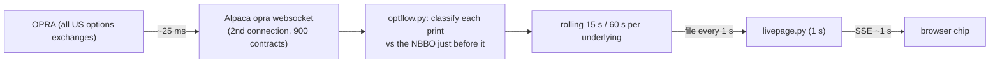

# 21 · 15s C/P and 1m C/P chips (live aggressor flow)
[← Index](README.md)

**Where:** on each tile's chip row, first in the row: `15s C/P 2.3`98% and `1m C/P 1.8`97%.
**Source:** Alpaca OPRA websocket (real-time, consolidated options trades and NBBO quotes), streamed on the Mac mini by `com.oid.desk.optflow`. Unusual Whales is not involved. Added Mon 10/19/2026 at 11:18 AM PT.

## What it shows
For each underlying, over the last **15 seconds** and the last **60 seconds**:

**C/P = premium paid by aggressive call buyers ÷ premium paid by aggressive put buyers**

* Green (≥ 1.25): call buyers are lifting offers faster than put buyers.
* Red (≤ 0.80): put buyers are the ones paying up.
* Amber: roughly balanced.
* **Grey:** don't read it. Either the window is *thin* (fewer than 5 prints) or the stream is *stale* (no print for this name for more than 30 s during market hours).
* `∞`: call buys with zero put buys. `—`: no buys at all in the window.
* Small superscript %: **coverage**, the share of premium printed in our streamed contracts that we could classify as a buy or a sell. Multi-leg prints and prints with no usable quote count against it.
* Hover for details: call-buy $, put-buy $, **net aggressor premium** = (call buy − call sell) − (put buy − put sell), print count, coverage, contracts streamed, and seconds since the last print.

## How each print is classified (quote rule, Lee-Ready)
| Print vs the NBBO just before it | Side |
|---|---|
| price ≥ ask | **BUY** |
| price ≤ bid | **SELL** |
| inside the spread, above mid / below mid | BUY / SELL (nearest side) |
| exactly at mid | tick test: up-tick = BUY, down-tick = SELL, otherwise the previous side, otherwise neutral |
| no quote yet, crossed or locked quote, quote more than 2 s older than the print, or spread > 50% of mid | **unclassified** (counts against coverage) |
| multi-leg (`f g h i j l m t u`) or stock-tied (`k n o p q r s`) condition | **excluded** as "complex": spread legs are priced as a package, so leg vs NBBO tells you nothing |
| cancel, late, or out-of-sequence (`A`–`H`) | dropped |

The first live sample (11:16 AM PT, 1,414 single-leg prints) split like this: 83% strictly at the bid or ask, 10% inside the spread on the nearest side, 3% tick test, 2% neutral, 2% unclassified. In other words, about 96% of single-leg prints got a side, and about 10% of all prints were complex.

## Which contracts are streamed
Alpaca caps option quote subscriptions at 1,000. We use **900** and leave headroom for the main collector's held-contract marks.
* Universe: the 61 underlyings in the live-page allowlist. 57 are optionable; VTV, VUG, KEYS and MH have no chain.
* Per name: expiries from today through +21 days, with strikes within ±12% of spot (±5% for index ETFs). Contracts are ranked by **today's premium traded**.
* The budget is split by √(premium traded in the window), with a floor of 4 and a cap of 110 contracts per name. At 11:12 AM PT: SPY 74, QQQ 75, MU 54, TSLA 52, NVDA 42, META 37, … down to 4 for the thinnest names.
* The selection is redone **every 15 minutes**, and changes are applied as subscribe/unsubscribe diffs without reconnecting.
* Coverage of that window's volume: SPY 88%, QQQ 85%, NVDA 87%, TSLA 93%, MU 83%. Thin names come in at 25–60%. The full table is in `~/oid-optflow/data/optflow-subs.json`.

## Latency (measured Mon 10/19/2026, 11:12–11:21 AM PT)
| Stage | Median | p95 |
|---|---|---|
| Exchange timestamp → received on the mini | 12–26 ms | 23–42 ms |
| Last print received → livepage build | 0.6 s | 1.4 s |
| optflow computed → SSE event on the mini | 0.52 s | 0.94 s |
| mini → your browser (Tailscale, from the earlier study) | 0.18 s | 0.20 s |
| **Print → chip on your screen** | **≈ 1 s** | **≈ 2 s** |
| Robinhood quote `updated_at` vs the mini's newest OPRA print at the same moment (NVDA 217.5C, QQQ 720C, QQQ 719P 0DTE; 3 rounds) | RH 4.5–5.8 s older (includes ~1–2 s of connector call overhead) | |

Compare the UW 15m chip, now shown in *italics* as the slow one, and the UW 5m chip: their data is typically about 3–7 minutes old.

## Caveats
* Quote-rule accuracy on modern options tape is roughly 75–85% per print. Read the chips as direction, not exact numbers.
* A 15 s window on a thin name may hold only a few prints. That's why the grey rule exists.
* "Buying puts" can be hedging; "selling calls" can be overwriting. The chip shows who paid up, not why.
* Soft color only, same as the UW chips. It never elevates or vetoes a setup on its own.

## Ops
* Service: `~/oid-optflow/optflow.py` (launchd `com.oid.desk.optflow`, KeepAlive). It uses the oid-quote venv.
* Endpoints (loopback only): `127.0.0.1:8792/v1/optflow`, `/v1/health` (includes coverage), `/v1/recent?sym=NVDA` (last 50 classified prints).
* File: `~/oid-optflow/data/optflow.json` (written every 1 s). The livepage hides the chips if the file is more than 10 s old.
* Stop: `launchctl bootout gui/$(id -u)/com.oid.desk.optflow`. The chips then disappear and nothing else changes.

## Momentum arrow (▲ ▼ –), added Mon 10/19/2026 11:42 AM PT
Spec and math: [22-cp-momentum-spec.md](22-cp-momentum-spec.md).
* Every 15 s (:00/:15/:30/:45), optflow saves each name's 15s and 1m reading. It keeps the last 6 readings (90 s) in memory and logs them to `~/oid-optflow/data/cp-history/YYYY-MM-DD.jsonl` (RTH only; older days are gzipped and deleted after 365 days).
* The arrow is the slope of ln((call-buy+k)/(put-buy+k)) over the last 4 readings (45 s):
  * **green ▲** = rising toward calls
  * **red ▼** = falling toward puts
  * **grey –** = flat
* No arrow when there are fewer than 3 valid readings, when the latest reading is thin, stale or overlaps a reconnect, or when the chip itself is grey. The chip body color is unchanged.
* The arrow updates on the 15 s boundary, while the number next to it updates every second. A red 0.7 with a green ▲ can mean either that put buying is easing or that the arrow hasn't caught up yet. The tooltip shows the last 6 readings.
* The 15s readings are noisy. Treat the **1m arrow** as the trend and the 15s arrow as the "now". The deadband (15s: on at 0.35/min, off below 0.20; 1m: on at 0.20, off below 0.10) will be re-tuned from the JSONL.
* Endpoints: `optflow.json` → `underlyings.<SYM>.mom.{15s,60s} = {d, s, nv, h, rr}`; `127.0.0.1:8792/v1/history?sym=NVDA` returns the raw slots with reasons.
* Kill switch: set `OID_OPTFLOW_MOMENTUM=0` in the optflow plist and restart. The arrows disappear and the chips stay. `OID_OPTFLOW_HIST_LOG=0` turns off only the disk log.
* Patches (idempotent, re-runnable): `~/oid-optflow/patch_optflow_mom.py <optflow.py>` and `~/oid-optflow/patch_livepage_mom.py ~/oid-live-page`.
