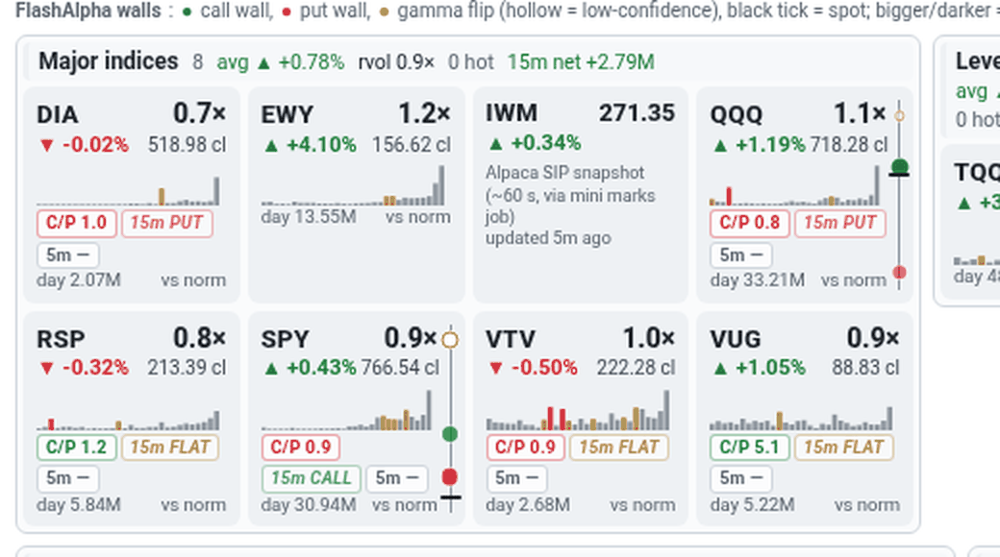
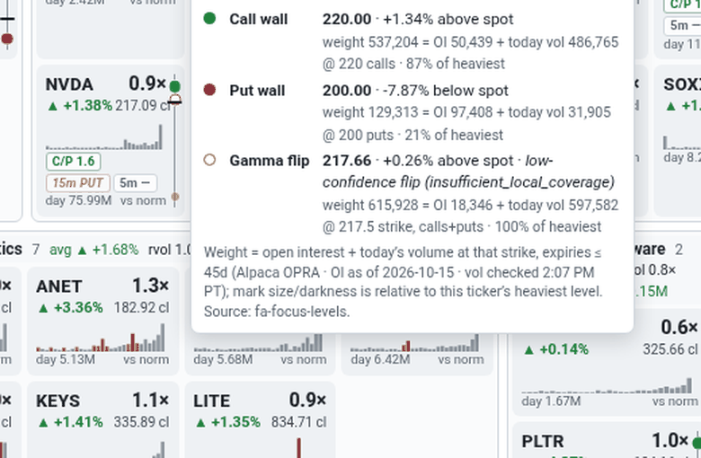

# 23 · Wall and flip marks (right edge of each tile)
[← Index](README.md)

*Added Mon 10/19/2026, 2:10 PM PT.*

Each stock tile that has FlashAlpha levels gets a thin vertical scale on its **right edge**. It answers two questions at a glance: *which level is spot closest to?* and *which of the three levels is the heavy one?*



## What the marks are
| Mark | Meaning |
|---|---|
| <span style="color:#1a7f37">●</span> green dot | **Call wall**: the strike where dealer call gamma is biggest. It often acts as a cap or a magnet. |
| <span style="color:#cf222e">●</span> red dot | **Put wall**: the strike where dealer put gamma is biggest. It often acts as a floor. |
| <span style="color:#bf8700">●</span> amber dot | **Gamma flip**: the price where dealer gamma changes sign. Above it, moves tend to get damped; below it, they tend to speed up. |
| <span style="color:#bf8700">○</span> hollow amber ring | Same flip, but FlashAlpha marked it **low-confidence** (status other than `available`, e.g. `insufficient_local_coverage`). Read it as approximate. |
| black horizontal tick | **Spot**, the tile's last price (close after hours). |
| dashed grey line, faded scale | The walls are **STALE** (see below). |

**Position.** The scale runs from the lowest to the highest of the four prices (spot + 3 levels) with 8% padding; higher prices are at the top. So the dot closest to the black tick is the nearest level. Example from the 10/19 close: SPY's tick sits *under* both the 767 put wall and the 768 call wall (spot 766.54), with the 770.15 flip at the top.

A level FlashAlpha didn't give (e.g. **no flip** for AMD, PLTR, IREN, CRWV, CBRS, INTC on 10/19) is simply missing. Futures, VIX, IWM and any ticker without FlashAlpha levels show no scale at all.

## What the size and darkness mean (weight)
Bigger and darker = heavier. For each level the page computes one **weight number**:

```
weight = open interest + today's option volume, at that strike
         call wall → calls at the call-wall strike
         put wall  → puts at the put-wall strike
         flip      → calls + puts at the listed strike nearest the flip
         (all expiries from today out to 45 days, summed)
```

The three weights are then scaled **within the ticker**: the heaviest of its three levels gets the full-size, full-color dot, and the others shrink and fade in proportion (size ∝ √share). Sizes are **not** comparable across tiles; a big dot on IREN and a big dot on SPY just mean "heaviest of that ticker's three".

Intraday, today's volume usually dominates the sum (0DTE strikes in SPY/QQQ trade far more than their open interest). The tooltip shows both parts so you can tell "big positioning" (OI-heavy) from "busy today" (volume-heavy).

| Data | Source | Refresh |
|---|---|---|
| Wall / put wall / flip prices | FlashAlpha, read from local cache files on the mini (**no FlashAlpha calls from the page**) | whenever the desk refreshes them (see below) |
| Open interest per contract | Alpaca options contracts list (read-only, free) | once per strike per day (Alpaca's OI date is shown; it can lag 1–2 sessions) |
| Today's volume per contract | Alpaca OPRA option snapshots (`dailyBar`, free) | every 5 min in market hours, hourly otherwise |

## Hover or tap for the numbers
Hover the scale (desktop) or tap it (phone; tap again or anywhere else to close). Tapping the scale doesn't open the table the way the rest of the tile does.



The tooltip lists, for each level: the price, **% distance from spot** (above/below), the low-confidence note for a hollow flip, and the weight as `weight N = OI a + today vol b @ strike`, plus "% of heaviest". The footer gives the FlashAlpha **as-of time**, the OI date, when volume was last checked, and which cache file the levels came from.

## STALE
| When | Rule |
|---|---|
| Market hours | Walls older than **20 minutes** → amber **STALE** tag in the tooltip, scale fades and its line turns dashed |
| Market closed | STALE only if the walls come from an **earlier session** than the tile's prices |
| Older than 4 days | Not drawn at all, so you never see last week's walls next to today's price |

## Where the levels come from (newest wins, per ticker)
1. `~/oid-live-page/data/fa-walls-pulse.json` — a copy of the box's walls pulse (all 20 names; on 10/19 the 11:55 AM PT pulse)
2. `market-data/latest/fa-focus-levels.json` — the 5-minute focus refresh (NVDA, META, QQQ on 10/19)
3. `market-data/latest/fa-levels.json` — the merged desk file
4. `market-data/latest/fa-flow-levels.json` — the morning open pull

**Known gap:** the box's walls pulse isn't pushed to the mini automatically yet. Until it is, non-focus names keep the last copied pulse and go STALE 20 minutes into the session. Focus names stay fresh from the 5-minute refresh.

## How to use it (soft context only)
* Black tick hugging a big green dot just above → spot is pressing a heavy call wall. A break needs real volume (check rvol and the [15s/1m chips](21-live-aggressor-chips.md)).
* Tick between a small flip dot and a big put dot below → the floor is the heavy level; a flip close by means the tape can speed up if price slips under it.
* A hollow flip right at spot (e.g. NVDA 217.66 vs 217.09 at the 10/19 close) is a coin-flip zone. Don't lean on it.

The marks never place, elevate or veto a trade. The traders' own rules (held 5-minute closes, chase limits) decide.
