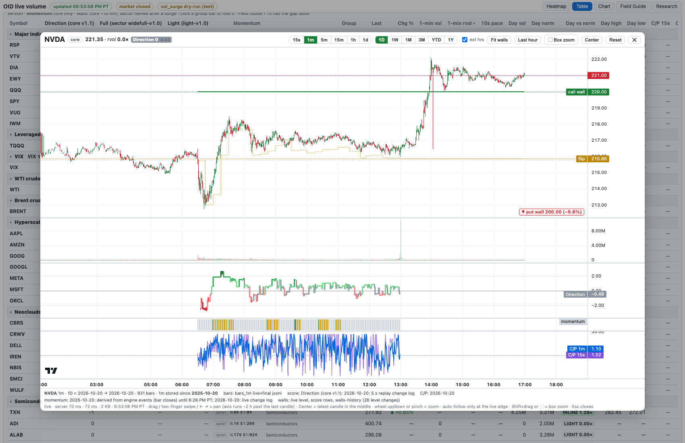
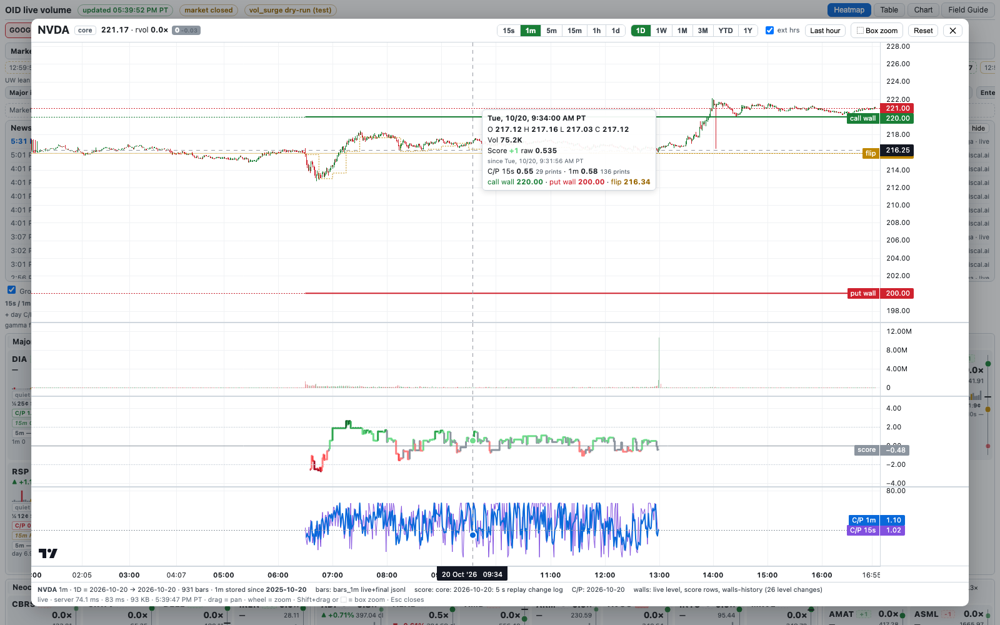
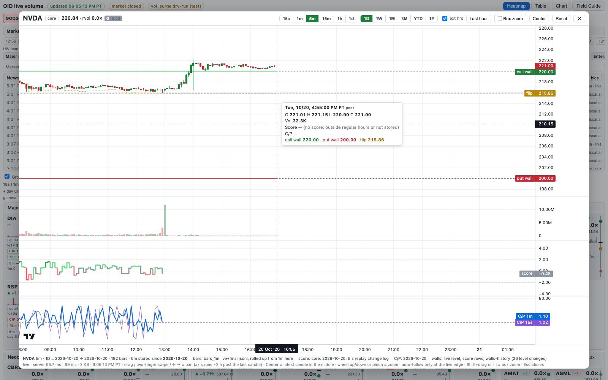
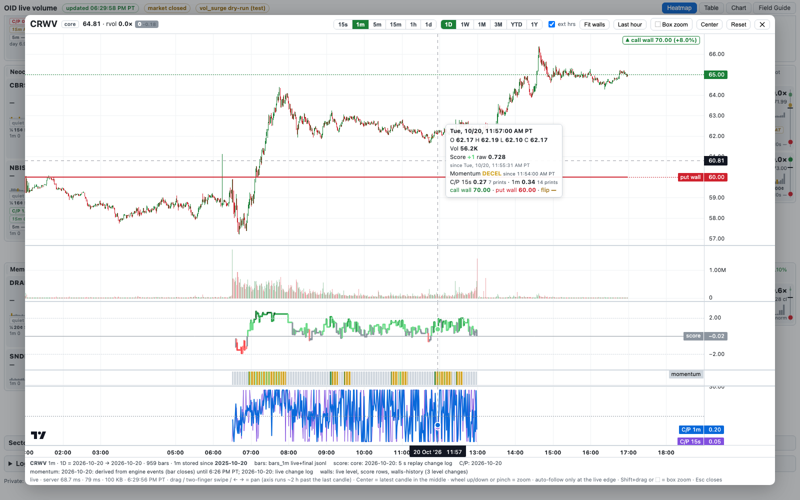
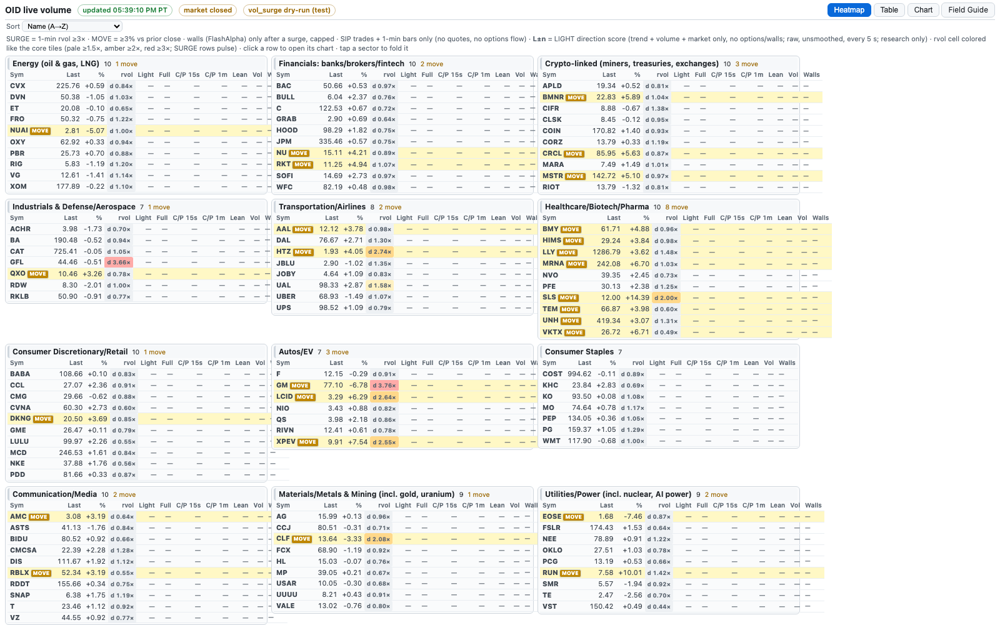
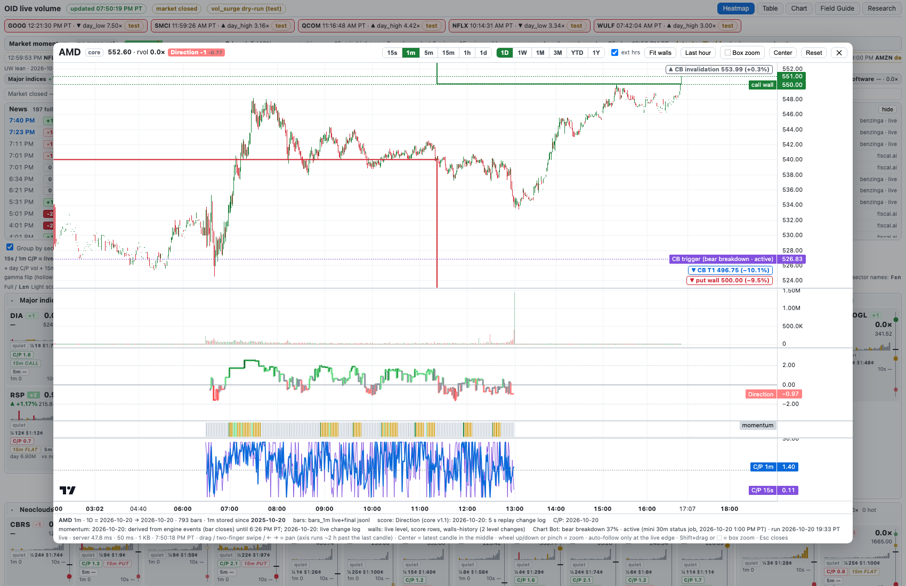

# 30 · Stock chart (click a ticker)

> Score names updated **Tue 10/20/2026, 6:55 PM PT**: lanes, tooltip, header chips and footer use the same names as the table (**Direction**, **Light**, **Full**, with the settings version).

> Added **Tue 10/20/2026, 5:45 PM PT**. Private live page on the Mac mini. All times PT (daily bars are labelled by ET trading date). Read-only research tool: **it never places orders**. Score shown **raw** (no smoothing).

## The workflow

1. A tile blinks red (SURGE) and its score badge leans positive.
2. **Click the ticker** — a core tile, a row in Table view, or a row in **Sector watch**. The chart opens in a panel over the page.
3. Read how it is guiding: price candles, volume underneath, the direction score lane under that, and the C/P lane at the bottom. Call wall / put wall / flip are drawn on the price.
4. **Esc** (or ✕, or a click outside the panel) closes it. The last ticker, interval, range and the ext-hours switch are remembered; the **Chart** button in the header reopens the last one.

Deep link (handy for bookmarks): `http://127.0.0.1:8791/#chart=NVDA/1m/1D` (also `/lh` = zoom to the last hour).

## What is on the chart (top to bottom, one shared time axis)

| Lane | What it shows | Colors |
|---|---|---|
| Price | Candles (OHLC) for the interval. **Call wall, put wall, flip as step lines** that change when the wall level changed, plus dashed lines with axis labels for the **live** levels the page shows right now. Walls do **not** stretch the price scale (see Price scale and walls). | green / red candles; call wall green, put wall red, flip amber dashed. Grey candles = pre/post 15 s bars priced from VWAP only, or "no trades" bars |
| Volume | Shares per bar | green = close ≥ open, red = close < open |
| Score (lane titles **Direction**, **Light**, **Full**) | **Raw direction score** (−3…+3) as a step line, colored by the whole-number score. Core names: **Direction (core v1.1)**. Sector names: **Light (light-v1.0)** (dashed) and **Full (sector widefull-v1.0)** (solid). Same names as the table columns ([24 §0](24-direction-score.md)) | +3 dark green … 0 grey … −3 dark red; grid lines at 0 and ±2 |
| Momentum | Thin ribbon under the score: momentum state at each bar's close (core names only; see below) | ACCEL dark green, RESUME light green, DECEL amber, quiet grey |
| C/P | Aggressor C/P **15 s** (purple) and **1 m** (blue), log scale, line at 1.0. Only drawn when C/P history exists for the name and range | |

**How lanes line up with price.** Every lane is put on the same bar grid as the candles: the value on a bar is **the last value known at that bar's close** (no look-ahead). The tooltip also shows the **range of scores inside the bar** and how many score changes happened in it, so nothing is hidden when several changes fall in one bar. Example: NVDA +1 → +2 at 7:00:01 AM (Field Guide page 29) shows on the 7:00 one-minute bar as "+2, range in bar +1…+2, 1 change".

The score and C/P are only drawn in **regular hours** (that's the only time they are computed). Pre/post bars show no score.

## Controls

| Control | What it does |
|---|---|
| **15s 1m 5m 15m 1h 1d** | Bar interval |
| **1D 1W 1M 3M YTD 1Y** | Range, counted back from the latest stored session. If the machine doesn't have that much history, the chart shows what it has and says so in the footer (e.g. "15s data on this machine starts 2026-10-19") |
| ext hrs | Include pre-market (4:00–6:30 AM) and after-hours (1:00–5:00 PM) bars |
| Mouse wheel up/down, or trackpad pinch | Zoom in/out around the cursor |
| **Two-finger sideways swipe** (Mac trackpad), or Shift + wheel | Pan, same zoom (sideways swipes never zoom) |
| **← / →** arrow keys | Pan by 10% of the visible width, same zoom |
| **Center** | Put the latest candle in the middle of the chart, same zoom |
| Drag | Pan. The chart is **not pinned to the right edge**: drag left to pull the last candle toward the middle (as on Robinhood); drag right to go back in time |
| **Shift + drag**, or **⬚ Box zoom** then drag | Zoom to the dragged time span |
| **Fit walls** | Off (default): the price scale fits the candles and off-screen walls show as edge markers. On: walls and flip are included in the scale |
| **Last hour** | Zoom to the last 60 minutes, plus the ~2 h of future axis on the right |
| **Reset** | Show the whole range again, with the default right-side space (see below) |
| Crosshair tooltip | Time (PT), O/H/L/C, volume, each score under its full name, e.g. **Direction (core v1.1)** (whole number, raw, since when, range inside the bar), or **Light (light-v1.0)** / **Full (sector widefull-v1.0)** for sector names, C/P 15 s and 1 m with print counts, call wall / put wall / flip at that bar |

## Future time axis and panning (changed 10/20, 6:05 PM PT)

The time axis **always runs about 2 hours of clock time past the latest candle**, so the latest candle sits clear of the price-axis labels (last price, call wall / put wall / flip) and the axis prints future times (e.g. 17:00, 18:00 after a 4:55 PM PT last bar).

| Interval | Default future space |
|---|---|
| 15s | 480 bars (2 h) |
| 1m | 120 bars (2 h) |
| 5m | 24 bars (2 h) |
| 15m | 8 bars (2 h) |
| 1h | 2 bars (2 h) |
| 1d | max(12, 8% of the bars shown) trading days, weekends skipped |

- When the range is long, the space is never **less than about 60 px**, so on 15m/1M and 1h/3M it can be more than 2 hours (measured: 15m/1M = 62 bars, 1h/3M = 49 bars).
- Applied when the chart opens, on **Reset**, on **Last hour**, and when you change the interval or range. Box zoom shows exactly the span you dragged.
- **How it works:** the chart holds invisible time-only points for the future (no price, no volume, no tooltip), at least max(the default above, 70% of the bars, 200). That's why dragging, a two-finger swipe or ← → move the latest candle to the middle or further at the **same zoom**, and the axis keeps printing times there. Data lanes (price, volume, score, C/P) share this one time axis, so they all move together.
- **Why it didn't work before (6:01 PM PT report):** a Mac two-finger sideways swipe arrives as a wheel event. The chart library had wheel-scrolling off and read the swipe's small up/down part as **zoom**, so swiping zoomed instead of panning. Sideways-dominant swipes are now handled by the page and only pan. The axis also had no time points past the last bar, so it ended at the last candle.

## Price scale and walls (changed 10/20, 6:30 PM PT)

**Before:** the call wall, put wall and flip lines were part of the price scale, so a far wall squashed the candles flat (CRWV at about 65 with walls at 70 and 60).

**Now:**

- The price scale **fits the candles** (plus a small margin: 6% top, 5% bottom). Wall and flip lines are still drawn where they are on screen, but they no longer stretch the scale.
- A wall or flip **outside the visible price range** shows as a labelled marker at the **top or bottom edge** of the price lane, in the wall's color, with its distance from the last price: e.g. **▲ call wall 70.00 (+7.9%)** or **▼ put wall 60.00 (−7.6%)**. It uses the live level the page shows (else the last level in the wall history), and moves as you pan or zoom.
- **Fit walls** (button, off by default, remembered) puts the walls back into the scale, so you can see all three with the candles.

## Momentum lane (added 10/20, 6:30 PM PT)

A thin color ribbon **under the score lane** shows the momentum state at each bar's close: **ACCEL** dark green, **RESUME** light green, **DECEL** amber, **quiet** grey (same colors as the page's Momentum chip, [25](25-momentum.md)). The tooltip adds "Momentum DECEL since 11:54:00 AM PT" and how many state changes fell inside the bar.

- **Core names only** (the momentum engine doesn't run on Sector watch names). On a sector chart the tooltip says so and there is no ribbon.
- **History:** from 10/20 6:26 PM PT the state comes from the new **momentum change log** ([29](29-how-data-is-saved.md)). Before that (10/20 regular hours) it is **derived from the engine's bar-close events**: state = last ACCEL / DECEL / RESUME flag, quiet after 10 min without a flag, quiet from the 9:30 ET open. The footer names the source per day. Bars with no history show no ribbon and the tooltip says "no momentum history for this bar".

## Live updating

While the chart is open and the range includes today, it asks the mini every **5 s** for the bars from the last bar on (`since=`), replaces the last bar and appends new ones. **Auto-follow only at the live edge:** if the latest candle is on screen, a new bar scrolls the view by one bar so the candle keeps its spot, and the future axis is extended again so it still runs ~2 h past the latest candle. If you have panned or zoomed back so the latest candle is off screen, the view stays exactly where you left it; press **Reset** or **Last hour** to jump back. The header line (last price, % change, rvol, SURGE, score badge, C/P) comes straight from the page's own 1-second stream, so it matches the tiles exactly. The live wall lines are redrawn whenever the page's wall levels refresh (core every ~10 min; Sector watch on surge).

## Data sources per interval

| Interval | Past days | Today | History on the mini (10/20) |
|---|---|---|---|
| 15s | `archive/parquet/volume_5s` (5 s buckets, 3 → 1) | `archive/volume_5s/date=…/part-oid-quote-N.jsonl` (live) | **core since 10/19**; **Sector watch since 10/20 3:08 PM PT** (after hours only; first full session 10/21) |
| 1m | `archive/parquet/bars_1m` (final REST copy wins over the live copy) | `archive/bars_1m/…jsonl` (live websocket bars + 2:00 / 5:15 PM final copies) | core since **2025-10-20** (1 year incl. pre/post); Sector watch since **2026-09-15** (bar store, regular hours only) + archive from 10/20 |
| 5m / 15m / 1h | `archive/parquet/bars_5m`, `bars_15m`, `bars_1h` | rolled up from today's 1m here (session-bounded, 1h anchored 9:30 ET, same rule as the archive) | as 1m |
| 1d | `archive/parquet/bars_1d` (Alpaca daily) | rolled up from today's regular-hours 1m | core since 2025-10-20; Sector watch since 2026-09-15 (rolled up from regular-hours 1m) |
| Score (core) | `~/oid-data/score/changes-YYYYMMDD.jsonl` (live) → `replay-YYYYMMDD/changes-…` (5 s replay) → `scores-YYYYMMDD.jsonl` / `backfill-scores-…` (15-min grid) | live `changes-YYYYMMDD.jsonl` from 10/21 | 10/19 = 15-min backfill grid; 10/20 = 5 s replay; live change log from Wed 10/21 |
| Score (Sector watch) | `changes-wide-…` (light), `changes-widefull-…` (full), else the `replay-…-wide` files | live files | light from 10/20 (replay); full from 10/21 |
| C/P | `~/oid-optflow/data/cp-history/YYYY-MM-DD.jsonl(.gz)` | same file, read incrementally | core since 10/19; Sector watch `cp-history-wide` starts 10/21 |
| Walls | see below | | |

Change rows only carry the raw score at the moment the whole-number score changes, so between changes the lane holds the last raw value (the badge in the header is the live raw value).

## Wall history (levels that move over time)

The price lane draws the call wall, put wall and flip **as they were at each bar**, not just today's levels. Sources, merged by the time each level was computed (`as_of`):

1. **`~/oid-data/walls-history/walls-YYYYMMDD.jsonl`** — new 10/20: the live page appends one row every time a wall level it shows changes (checked every 30 s; core = best of fa-walls-pulse / fa-focus-levels / fa-levels / fa-flow-levels, Sector watch = fa-walls-wide). Row: `sym, tier, as_of (epoch s), as_of_pt, cw, pw, gf, gf_status, src, rec_t`.
2. **Walls inside the score rows** (`ctx.walls` / `comps.walls` + `comps.flip`, `as_of = t − age_s`) — this is what gives history for 10/19 and 10/20, before the recorder existed.
3. **The live level** the page shows right now.

Same rule as the tiles: a level older than **4 days** is not drawn.

## Endpoints (read-only, loopback / tailnet only)

| Route | What |
|---|---|
| `/chart.json?sym=NVDA&iv=1m&range=1D&ext=1[&since=<epoch s>]` | Bars + score + C/P + walls for the chart. `iv` = 15s 1m 5m 15m 1h 1d; `range` = 1D 1W 1M 3M YTD 1Y; `ext=0` = regular hours only; `since` = only bars from that bar on (live polling). gzip when the browser asks |
| `/chart.js`, `/chart.css` | The chart panel code |
| `/vendor/lightweight-charts.standalone.production.js` | TradingView Lightweight Charts 5.0.9 (Apache-2.0), served from the mini — no CDN |

Reply (arrays are parallel to `bars`): `bars[i] = [t, o, h, l, c, v, session p|r|a, flag]` (flag 0 = live/aggregated, 1 = final, 2 = priced from 5 s VWAP, 3 = no trades, 4 = rolled up here); `score.core|light|full[i] = [score, raw, max in bar, min in bar, changes in bar, since t]`; `cp[i] = [cp15, cp60, prints15, prints60]`; `walls[i] = [cw, pw, gf]`; plus `wall_events`, `avail` (first stored date per interval), `sources`, `notes`, `k`, `gen_ms`.

**Server-side downsampling.** At most **4,000 bars** per chart. If a range has more (e.g. 1m over 1Y), the mini merges k bars into one (proper OHLC, never across days) and the footer says "1 bar = k × 1m".

## How it runs (CPU stays low)

- `chart_backend.py` is one child process of the live page (oid-desk venv Python + duckdb, `nice 10`, duckdb limited to 2 threads / 256 MB). It starts on the first chart request and **exits after 15 idle minutes**.
- Past days are cached 10 min, today's bars 3 s; score and C/P files are read once and then only the new bytes.
- Measured 10/20 after hours (gzip size, warm): NVDA 15s/1D 3,836 bars 65 KB in 42 ms (cold 0.6 s); 1m/1D 20 KB 12 ms; 5m/1W 18 KB; 15m/1M 26 KB; 1h/3M 22 KB; 1d/1Y 6 KB. OXY 1m/1D 8 KB. A live 5 s poll is 1–8 KB.
- `/healthz` shows `chart.requests`, `chart.avg_ms`, `chart.err`. The host monitor (`~/oid-data/host/`) logs the backend like any other process.

## Sector watch rvol coloring (changed 10/20)

**Before:** Sector watch rows only turned pink when 1-min rvol was ≥3× (SURGE flag) and yellow on a ≥3% move. There was no graded color for 1.5× / 2×, and nothing pulsed — unlike the core tiles.

**Now:** the rvol cell uses **the same colors and thresholds as the core tiles** (grey under 1.5×, pale yellow ≥1.5×, amber ≥2×, red ≥3×; after the close it colors by day volume vs norm, like the tiles), and SURGE rows (≥3× in regular hours) **pulse red** the way a hot tile does. Click any row to open its chart.

## Chart Bot scenario lines (added 10/21, shadow only) <!-- LEARN-1021 -->

Chart Bot's daily scenario (method **CB-SCN-V1**) is drawn on the price lane for the 37 names it covers. Only the **primary** scenario is drawn:

| Line | Color / style | Meaning |
|---|---|---|
| **CB trigger** (label shows the scenario and its status) | purple, thin dashed, axis label | the level that starts the scenario (close-above / close-below, or touch for pullback / failed-rally) |
| **CB T1** | blue, thin dashed | first target |
| **CB invalidation** | grey, thin dashed | the closing stop |
| **CB range high / low** (RANGE_CHOP only) | purple, thin dashed | the range that should hold |

- The lines **never stretch the price scale**, not even with **Fit walls** on. A level outside the view shows as an **edge marker** at the top or bottom, like the walls (example above: `▲ CB invalidation 553.99 (+0.3%)`, `▼ CB T1 496.75 (−10.1%)`).
- The footer line **Chart Bot:** shows the label, the calibrated score, the status, where the status came from and when, and Chart Bot's run time.
- **Status** comes from the mini's 30-minute status job (`com.oid.desk.chart-scn-status`, `~/oid-data/chart-scenarios/status-live.json`) when its prediction id matches the synced file, else from Chart Bot's own `latest.json`. Values: active, triggered, target_hit, target2_hit, void, expired, held.
- **One status engine (10/21):** the 30-minute job (`~/oid-score/chart_scn_live.py`) rolls completed RTH 30-min bars from the mini's own 1-min bars into `~/oid-data/chart-scenarios/bars-30m-live.csv` and runs **Chart Bot's own code**: `~/oid-desk/chart-bot/run_scenarios.py --status-only` (`scenario_status.py`, copied from the box). So the box and the mini apply exactly the same rules. On 10/20 bars, all 37 primaries and all 111 alternates matched Chart Bot's file. The old `chart_scn_status.py` is retired (kept as a backup).
- **Alternates** now get a status too. The footer adds `alts: bull breakout active, ...`, and score_features logs `cs_alt1_label`, `cs_alt1_status` and `cs_alt_n_live` (page 33).
- **Where the file comes from:** Chart Bot writes `chart-bot/scenarios/latest.json` on the box (daily run plus 3 status refreshes). The box desk-state push (`quotes/mirror_poller.py`, the same path that already sends paper trades and configs) copies it to the mini at `~/oid-desk/desk/chart-bot/scenarios/latest.json` within about a minute of each change.
- **Calibration warning:** primaries' calibrated score runs hot (about **44% estimated vs 36% realized**). Read it as a ranking, not a probability. Soft colour only: it never elevates a name on its own and is not in any score.
- Names Chart Bot doesn't cover show "Chart Bot: no scenario for this ticker" in the footer and no lines.

## Known limits

- **15 s history:** core from 10/19; Sector watch only from 10/20 after hours (full sessions from 10/21).
- **Pre/post 15 s bars** have no open/high/low/close in the 5 s archive (only VWAP), so they are flat grey candles at the VWAP.
- **Sector watch 1m before 10/20** is regular hours only (bar store); no pre/post.
- **Score history:** 10/19 is a 15-minute grid, 10/20 is the 5 s replay; the live change log starts 10/21. Daily charts have only those days of score.
- **C/P history:** core from 10/19; Sector watch from 10/21.
- **Chart Bot lines** show today's primary only (no history of earlier scenarios on the chart); statuses update every 30 min in market hours.
- **Walls before 10/20** come only from the walls the score saw (none before 10/19).
