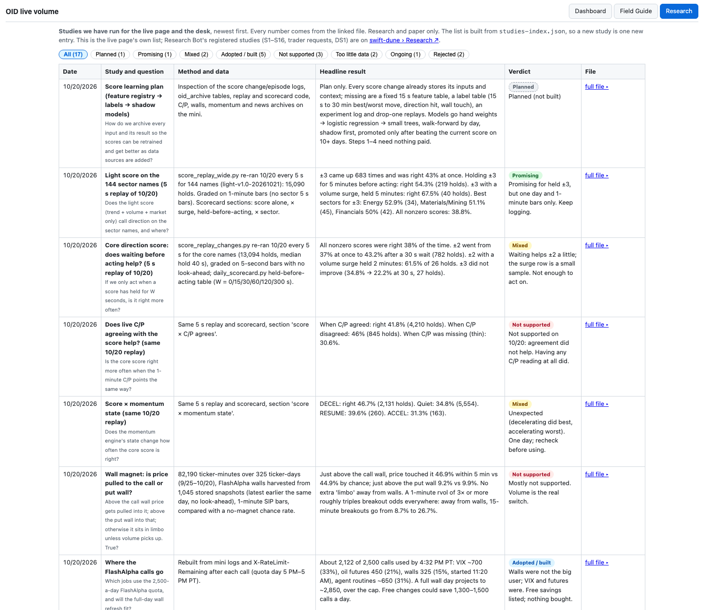

# 32 · Research tab (studies run so far)
[← Index](README.md)

> Added **Tue 10/20/2026, 6:55 PM PT**. Header button **Research**, next to Field Guide. Address: `/guide/research/` (also `/research`).

**What it is.** The live page's own list of every study done so far for the page and the desk: the score replays, the wall magnet test, the C/P studies, FlashAlpha usage, the ladder dry run, calibration, rejected ideas and planned work. Newest first.

| Column | Meaning |
|---|---|
| Date | When the study was run (PT) |
| Study and question | Short title, then the question in plain words |
| Method and data | What was measured, on which data and days |
| Headline result | The main numbers, copied from the study file (no new numbers) |
| Verdict | A colored tag (Planned, Promising, Mixed, Adopted / built, Not supported, Too little data, Ongoing, Rejected) and one line |
| File | **full file ▸** opens the study's markdown file on the same page; **raw** opens the file itself |

The filter chips above the table show how many studies have each verdict.

**How it is built.** The page reads `guide/research/studies-index.json` on the mini. Adding a study = copy its markdown file into `guide/research/files/` and append one object to `studies` (id, date, title, status, question, method, result, verdict, file). The master copy of the index is `research/studies-index.json` in the desk repo.

**Not the same as Research Bot's tab.** Research Bot's registered studies (S1–S16, trader requests TR-1…TR-5, DS1) live on swift-dune's Research tab (`https://swift-dune-cs3e.here.now/#research`). This tab links there and does not copy them.
