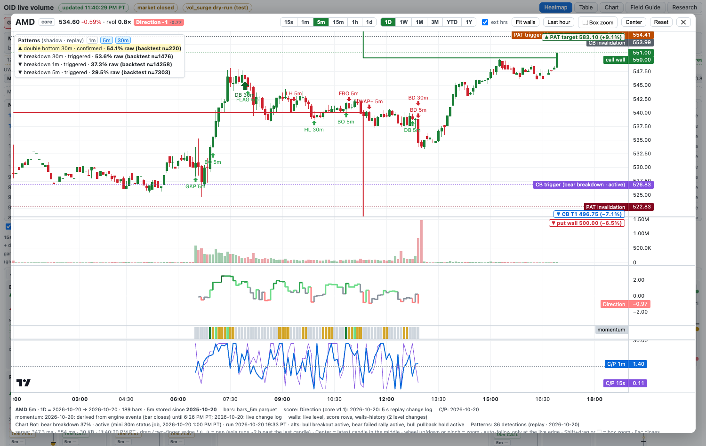

# 34 · Chart-pattern detector (shadow, added 10/21)

**Shadow only.** The detector finds chart patterns on the mini's own bars, records each one with a timestamp and a prediction, and grades them later. It **never feeds a live score or a trade**. That stays true until Jeffrey approves a promotion. Research and paper only; no paid calls, no LLM or vision model. The code is the standard library only.



## What runs

| Job | When | What it does |
|---|---|---|
| `com.oid.desk.patterns` (`~/oid-score/pattern_daemon.py`) | Always loaded; works **6:30 AM–1:01 PM PT** weekdays, once per 1-min bar close (+8 s) | Reads today's 1-min SIP bars for all **205 tracked tickers** (61 core names from the core bar store + 144 Sector watch names). Each closed 1-min bar goes to the **1m** engine; each completed 5-min and 30-min bucket goes to the **5m** and **30m** engines. Every state change is appended to the archive, and `~/oid-data/patterns/live.json` is rewritten. |
| `com.oid.desk.pattern-grade` (`pattern_learn.py grade`) | Weekdays **1:50 PM PT** | Labels every detection from the last 10 archive days, updates the live hit rates, writes the scorecard and appends one row to `experiments.jsonl`. |
| `pattern_learn.py backtest` (by hand) | When rules change | Runs every stored session through the same engines to rebuild `base-rates.json`. |
| `pattern_learn.py replay --date D` (by hand) | Testing | Runs one day through the engines and writes `part-patterns-replay-1.jsonl`. |

- **Kill switch:** `touch ~/oid-data/patterns/disabled`.
- **Restarts are safe:** on a restart the engines re-warm on prior sessions and replay today's bars. Records already in today's archive (same `rec_id`) are not written again.
- **One rule set:** live, replay and backtest use the same engine code (`patterns.py`, version `pat-v1-20261021`). Checked: a forced-open daemon pass over 10/20 wrote exactly the same 18,967 records as the replay.

## Patterns and their rules

Pivots are swing highs and lows confirmed **k** bars later (k = 3 on 1m/5m, 2 on 30m). ATR is a 14-bar Wilder ATR on the pattern's own interval. W is the window: 20 bars (1m), 12 bars (5m) or 10 bars (30m).

| Pattern | Dir | Detected when | Trigger / target / invalidation |
|---|---|---|---|
| `range` | 0 | High−low over the last W/2 bars ≤ 1.5 ATR, and the 5-bar mean TR < 0.8 ATR (compression). **forming**, then **confirmed** after W tight bars | context only; a close outside ends it as `completed` with `break_dir`; it widens past 2 ATR → `failed` |
| `bull_flag` / `bear_flag` | ±1 | Tight range (as above), pole of ≥ 3 ATR over the W bars before it, flag height ≤ half the pole | flag edge / edge ± pole / other edge |
| `breakout` / `breakdown` | ±1 | Close beyond a **confirmed range** edge; or a close through a **key level**: prior-session high/low, or the 30-min opening range high/low (1m/5m) | range: edge / edge ± range height / range middle. Level: level / level ± 3 ATR (2 ATR on 30m) / level ∓ 1 ATR. `vol_confirm` = bar volume ≥ 1.5× the last 20 bars (`rvol`) |
| `failed_breakout` / `failed_breakdown` | ∓1 | A breakout closes back through its level within 5 bars | level / other side of the range (or mirrored target) / breakout extreme ± 0.1 ATR |
| `head_shoulders` / `inv_head_shoulders` | ∓1 | 5 alternating pivots: head ≥ 0.5 ATR beyond both shoulders, shoulders within 1 ATR, troughs (peaks) within 1 ATR | neckline = mean of the two troughs (peaks) / neckline ∓ (head − neckline) (measured move) / right shoulder ± 0.25 ATR |
| `double_top` / `double_bottom` | ∓1 | Two pivots within 0.5 ATR, ≥ 2k+2 bars apart, middle pivot ≥ 1.5 ATR away | middle pivot (neckline) / neckline ∓ height / outer pivot ± 0.25 ATR |
| `vwap_reclaim` / `vwap_loss` | ±1 | (1m, 5m) a close across session VWAP after 3 closes on the other side | VWAP / VWAP ± max(depth of the last 10 bars, 1 ATR) / that 10-bar low (high) |
| `higher_low` / `lower_high` | ±1 | Trend shift: in a down leg (lower highs and lows) a new pivot low holds ≥ 0.25 ATR above the last low (mirror for lower high) | last pivot high (low) / trigger ± (trigger − new pivot) / new pivot ∓ 0.1 ATR |
| `gap_up` / `gap_down` | ∓1 (predicts the **fill**) | (5m, first bar of the session) open ≥ 0.6% from the prior close and ≥ 0.25 daily ATR, not filled in the first bar | first 5-min bar's low (high) / **prior close** (gap-fill target) / first bar's high (low) ± 0.1 ATR; `fill_status` open → filled; horizon = rest of the session |

- **States:** `forming` → `confirmed` → `triggered` (close beyond the trigger) → `completed` (target touched) | `failed` (close beyond invalidation, or a breakout closing back inside) | `expired` (horizon passed).
- **Horizon:** 30 bars on 1m, 24 bars on 5m (2 h), 26 bars on 30m (2 sessions); a gap runs to the end of the session. Only one detection per pattern family per ticker and interval is active at a time, with a cooldown before the next one (10 / 6 / 4 bars).
- **confidence_raw** (0–1): a fixed heuristic per pattern (symmetry, size in ATR, volume confirmation). It is not a probability and is not calibrated.

## Each record (archive)

`~/oid-data/archive/patterns/date=YYYY-MM-DD/part-patterns-live-<n>.jsonl` gets one line per state change (the replay file is `part-patterns-replay-1.jsonl`, with `mode: "replay"`).

- **Keys:** `rec_id` = `det_id:state` (archive key); `det_id` = ticker-interval-pattern-bar start.
- **Core fields:** `ts` (bar close epoch), `t_pt`, `ticker`, `interval`, `pattern`, `direction`, `state`, `key_levels` {trigger, target, invalidation, plus neckline, range, level name, prior close …}, `confidence_raw`, `horizon` {bars, minutes}, `detector_version`, `px`, `atr_bar`, `detected_ts`, and `rvol` / `vol_confirm` / `gap_pct` / `fill_status` where they apply.
- **Prediction:** `prob_est` with `prob_source` and `prob_n`, plus `prob_backtest` / `n_backtest` / `prob_live` / `n_live`, and `prob_note: "n<20: low sample"` when n < 20.
- **Context at that moment:** `ctx` {score_core, score_light, score_full (from the scorers' latest files, ≤ 10 min old), mom (live page momentum state, core names), ctx_src}. Replays take scores from that day's score_features Parquet. RTH momentum was not archived on 10/20, so replays have no momentum.

Real record (10/20 replay):

```json
{"ts":1792503600,"ticker":"AG","interval":"5m","pattern":"gap_down","direction":1,"state":"triggered",
 "det_id":"AG-5m-gap_down-1792503000","key_levels":{"trigger":15.73,"target":15.97,"invalidation":15.5833,"prior_close":15.97},
 "confidence_raw":0.575,"horizon":{"bars":77,"minutes":385},"detector_version":"pat-v1-20261021","px":15.91,"atr_bar":0.0791,
 "gap_pct":-1.75,"fill_status":"open","prob_est":0.556,"prob_source":"backtest","prob_n":500,
 "ctx":{"ctx_src":"replay (score_features parquet; momentum not archived in RTH)","score_light":1},
 "mode":"replay","rec_id":"AG-5m-gap_down-1792503000:triggered","t_pt":"2026-10-20 6:40:00 AM PT"}
```

## Probabilities and grading

- **What a hit means:** a triggered detection is graded on **1-min bars** from the trigger bar's close. **target_hit** = target touched first; **invalidated** = a 1-min close beyond invalidation; **expired** = neither within the horizon (market minutes). Also recorded: minutes to outcome (wall clock), MFE/MAE in bp and in bar-ATR. Untriggered detections are labelled `not_triggered`; range is labelled `context`.
- **Base rates** (`~/oid-data/patterns/base-rates.json`): built from every stored 1-min session (9/15–10/20; the first 2 sessions per ticker are warm-up) of all 205 tickers. That gives 140,308 graded detections over 42 pattern × interval × direction keys, each with n, hits, median minutes to hit, median MFE/MAE and the vol-confirmed hit rate. The smallest key has n = 128, so no key is under 20 yet. **These rates are in-sample for every replayed day.**
- **prob_est** = the backtest rate for the pattern + interval + direction (`prob_source: "backtest"`, with n). Once the live grader has **n ≥ 20** final live labels for a key, it switches to the live rate (`prob_source: "live"`), and both stay in the record and the UI. It is conditional on the trigger; raw, not smoothed.
- **Nightly:** labels go to `archive/pattern_labels/date=D/part-pattern-grader-1.jsonl` (rewritten each night, because 30m horizons span days). Live rates → `base-rates.json` "live". Scorecard → `~/oid-data/patterns/scorecard-<D>.{md,json}`. One `pattern_scorecard` row → `~/oid-data/score/experiments.jsonl`.

Backtest highlights (hit rate, n):

| Pattern | 1m | 5m | 30m |
|---|---|---|---|
| breakout | 38.1% (11,548) | 31.1% (5,980); vol-confirmed 40.0% (1,540) | 48.2% (1,195) |
| breakdown | 37.3% (14,258) | 29.5% (7,303) | 53.6% (1,476) |
| double top / bottom | 53.2% / 53.9% | 54.2% / 55.0% | 62.5% (256) / 54.1% (220) |
| higher low / lower high | 64.2% / 64.9% | 59.8% / 54.4% | 67.3% (498) / 78.7% (503) |
| H&S / inverse | 37.4% / 36.4% | 44.7% / 38.4% | 45.3% (128) / 45.0% (140) |
| vwap reclaim / loss | 44.9% / 46.9% | 48.8% / 48.0% | — |
| bull / bear flag | 22.5% / 18.5% | 17.6% / 16.4% | 36.2% / 45.3% |
| gap fill (5m) | — | gap up 66.6% (602) · gap down 55.6% (500) | — |

Higher-low and lower-high rates are high partly because entry is the trigger bar's close, which is already past the trigger and so closer to the target than to the invalidation.

## On the live page

- **Chart:** markers show the label and interval with an ▲ / ▼ arrow at the bar where the pattern was detected. Toggle 1m / 5m / 30m markers in the tag (default 5m + 30m). The **Patterns tag** (top left) lists active patterns: direction, interval, state and **raw prob with source and n**. Click one to draw its **dashed trigger (orange), target (green) and invalidation (dark red)** lines. They are price lines, so they never stretch the price scale; off-screen levels show as edge markers. The footer shows the detection count and its source (live or replay).
- **Table:** a **Patterns** column right after the score columns shows the top active pattern (highest prob): `▲ DB 30m 54%` and `+n` more. Hover for state, levels, prob source and n. The column sorts by prob. A dimmed value means the file is a replay, not live.
- `/patterns.json` (live page server) serves the top active pattern per ticker from `live.json`.

## In score_features (shadow fields)

Core and full rows (not light) carry `pattern_active`, `pattern_dir`, `pattern_prob`, `pattern_name`, `pattern_interval`, `pattern_state`, `pattern_prob_n`, `pattern_prob_src` and `age_pat` (page 33, source `patterns`). They are read from `live.json` only when it is `mode: live` and under 150 s old, so a replay file never leaks into live rows. No score uses them.

## 10/20 replay (verification)

205 tickers produced **8,665 detections and 18,967 records** in 6 s, with `prob_est` from the backtest:

| Pattern | Detections (1m / 5m / 30m) |
|---|---|
| breakout | 1,049 (635 / 351 / 63) |
| range | 1,009 (107 / 650 / 252) |
| lower high / higher low | 894 / 852 |
| double top / bottom | 802 / 723 |
| vwap loss / reclaim | 619 / 476 |
| breakdown | 580 |
| failed breakout / breakdown | 442 / 262 |
| inv H&S / H&S | 343 / 260 |
| bull / bear flag | 154 / 101 |
| gap down / up (5m) | 65 / 34 |

- **Replay grade:** 5,130 triggered and graded, 2,448 hit (47.7%). Scorecard: `scorecard-2026-10-20.md`.
- **Storage:** about 14 MB/day of JSONL at 10/20's activity. Labels are about 1 MB.

## Known limits

- **Rules:** pivots and levels are simple and deterministic. The 1m engine is noisy (most detections are 1m); read 5m and 30m first.
- **Base rates:** these come from 24 sessions of one regime. The live rates take over per key at n ≥ 20.
- **Gaps:** only the 5-min engine detects gaps.
- **Momentum:** only core names have a momentum state in the context.
- **Bars:** sector names have no live 5 s bars, so all engines use 1-min bars.


**Lead-lag extension (10/21):** this detector's triggered breakout, breakdown, failed-breakout, gap-fill and VWAP events also drive the shadow leader → follower predictions. See [35 · Lead-lag](35-lead-lag.md).

**Fix (10/21, GRADEFIX):** the first nightly grade with live labels crashed (KeyError minutes_to_outcome in patterns.aggregate). Label files drop None fields, so final "expired" labels have no minutes_to_outcome; aggregate() now reads it with .get() and skips it, as it already did for None. Grading math is unchanged. Re-run 2:43 PM PT the same day.
