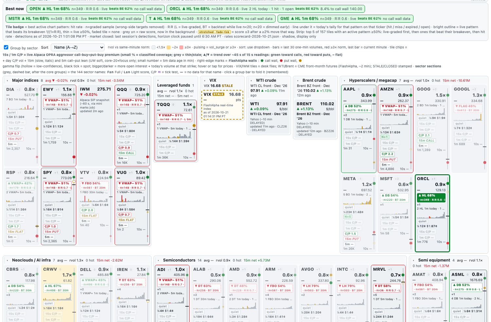

# 34 · Chart-pattern detector (shadow, added 10/21)

**Shadow only.** The detector finds chart patterns on the mini's own bars, records each one with a timestamp and a prediction, and grades them later. It **never feeds a live score or a trade**. That stays true until Jeffrey approves a promotion. Research and paper only; no paid calls, no LLM or vision model. The code is the standard library only.


## What runs

| Job | When | What it does |
|---|---|---|
| `com.oid.desk.patterns` (`~/oid-score/pattern_daemon.py`) | Always loaded; works **6:30 AM–1:01 PM PT** weekdays, once per 1-min bar close (+8 s) | Reads today's 1-min SIP bars for all **205 tracked tickers** (61 core names from the core bar store + 144 Sector watch names). Each closed 1-min bar goes to the **1m** engine; each completed 5-min and 30-min bucket goes to the **5m** and **30m** engines. Every state change is appended to the archive, and `~/oid-data/patterns/live.json` is rewritten. |
| `com.oid.desk.pattern-grade` (`pattern_learn.py grade`) | Weekdays **1:50 PM PT** | Labels every detection from the last 10 archive days, updates the live hit rates, writes the scorecard and appends one row to `experiments.jsonl`. |
| `pattern_learn.py backtest` (by hand) | When rules change | Runs every stored session through the same engines to rebuild `base-rates.json`. |
| `pattern_learn.py replay --date D` (by hand) | Testing | Runs one day through the engines and writes `part-patterns-replay-1.jsonl`. |

- **Kill switch:** `touch ~/oid-data/patterns/disabled`.
- **Restarts are safe:** on a restart the engines re-warm on prior sessions and replay today's bars. Records already in today's archive (same `rec_id`) are not written again.
- **One rule set:** live, replay and backtest use the same engine code (`patterns.py`, version `pat-v1-20261021`). Checked: a forced-open daemon pass over 10/20 wrote exactly the same 18,967 records as the replay.

## Patterns and their rules

Pivots are swing highs and lows confirmed **k** bars later (k = 3 on 1m/5m, 2 on 30m). ATR is a 14-bar Wilder ATR on the pattern's own interval. W is the window: 20 bars (1m), 12 bars (5m) or 10 bars (30m).

| Pattern | Dir | Detected when | Trigger / target / invalidation |
|---|---|---|---|
| `range` | 0 | High−low over the last W/2 bars ≤ 1.5 ATR, and the 5-bar mean TR < 0.8 ATR (compression). **forming**, then **confirmed** after W tight bars | context only; a close outside ends it as `completed` with `break_dir`; it widens past 2 ATR → `failed` |
| `bull_flag` / `bear_flag` | ±1 | Tight range (as above), pole of ≥ 3 ATR over the W bars before it, flag height ≤ half the pole | flag edge / edge ± pole / other edge |
| `breakout` / `breakdown` | ±1 | Close beyond a **confirmed range** edge; or a close through a **key level**: prior-session high/low, or the 30-min opening range high/low (1m/5m) | range: edge / edge ± range height / range middle. Level: level / level ± 3 ATR (2 ATR on 30m) / level ∓ 1 ATR. `vol_confirm` = bar volume ≥ 1.5× the last 20 bars (`rvol`) |
| `failed_breakout` / `failed_breakdown` | ∓1 | A breakout closes back through its level within 5 bars | level / other side of the range (or mirrored target) / breakout extreme ± 0.1 ATR |
| `head_shoulders` / `inv_head_shoulders` | ∓1 | 5 alternating pivots: head ≥ 0.5 ATR beyond both shoulders, shoulders within 1 ATR, troughs (peaks) within 1 ATR | neckline = mean of the two troughs (peaks) / neckline ∓ (head − neckline) (measured move) / right shoulder ± 0.25 ATR |
| `double_top` / `double_bottom` | ∓1 | Two pivots within 0.5 ATR, ≥ 2k+2 bars apart, middle pivot ≥ 1.5 ATR away | middle pivot (neckline) / neckline ∓ height / outer pivot ± 0.25 ATR |
| `vwap_reclaim` / `vwap_loss` | ±1 | (1m, 5m) a close across session VWAP after 3 closes on the other side | VWAP / VWAP ± max(depth of the last 10 bars, 1 ATR) / that 10-bar low (high) |
| `higher_low` / `lower_high` | ±1 | Trend shift: in a down leg (lower highs and lows) a new pivot low holds ≥ 0.25 ATR above the last low (mirror for lower high) | last pivot high (low) / trigger ± (trigger − new pivot) / new pivot ∓ 0.1 ATR |
| `gap_up` / `gap_down` | ∓1 (predicts the **fill**) | (5m, first bar of the session) open ≥ 0.6% from the prior close and ≥ 0.25 daily ATR, not filled in the first bar | first 5-min bar's low (high) / **prior close** (gap-fill target) / first bar's high (low) ± 0.1 ATR; `fill_status` open → filled; horizon = rest of the session |

- **States:** `forming` → `confirmed` → `triggered` (close beyond the trigger) → `completed` (target touched) | `failed` (close beyond invalidation, or a breakout closing back inside) | `expired` (horizon passed).
- **Horizon:** 30 bars on 1m, 24 bars on 5m (2 h), 26 bars on 30m (2 sessions); a gap runs to the end of the session. Only one detection per pattern family per ticker and interval is active at a time, with a cooldown before the next one (10 / 6 / 4 bars).
- **confidence_raw** (0–1): a fixed heuristic per pattern (symmetry, size in ATR, volume confirmation). It is not a probability and is not calibrated.

## Each record (archive)

`~/oid-data/archive/patterns/date=YYYY-MM-DD/part-patterns-live-<n>.jsonl` gets one line per state change (the replay file is `part-patterns-replay-1.jsonl`, with `mode: "replay"`).

- **Keys:** `rec_id` = `det_id:state` (archive key); `det_id` = ticker-interval-pattern-bar start.
- **Core fields:** `ts` (bar close epoch), `t_pt`, `ticker`, `interval`, `pattern`, `direction`, `state`, `key_levels` {trigger, target, invalidation, plus neckline, range, level name, prior close …}, `confidence_raw`, `horizon` {bars, minutes}, `detector_version`, `px`, `atr_bar`, `detected_ts`, and `rvol` / `vol_confirm` / `gap_pct` / `fill_status` where they apply.
- **Prediction:** `prob_est` with `prob_source` and `prob_n`, plus `prob_backtest` / `n_backtest` / `prob_live` / `n_live`, and `prob_note: "n<20: low sample"` when n < 20.
- **Context at that moment:** `ctx` {score_core, score_light, score_full (from the scorers' latest files, ≤ 10 min old), mom (live page momentum state, core names), ctx_src}. Replays take scores from that day's score_features Parquet. RTH momentum was not archived on 10/20, so replays have no momentum.

Real record (10/20 replay):

```json
{"ts":1792503600,"ticker":"AG","interval":"5m","pattern":"gap_down","direction":1,"state":"triggered",
 "det_id":"AG-5m-gap_down-1792503000","key_levels":{"trigger":15.73,"target":15.97,"invalidation":15.5833,"prior_close":15.97},
 "confidence_raw":0.575,"horizon":{"bars":77,"minutes":385},"detector_version":"pat-v1-20261021","px":15.91,"atr_bar":0.0791,
 "gap_pct":-1.75,"fill_status":"open","prob_est":0.556,"prob_source":"backtest","prob_n":500,
 "ctx":{"ctx_src":"replay (score_features parquet; momentum not archived in RTH)","score_light":1},
 "mode":"replay","rec_id":"AG-5m-gap_down-1792503000:triggered","t_pt":"2026-10-20 6:40:00 AM PT"}
```

## Probabilities and grading

- **What a hit means:** a triggered detection is graded on **1-min bars** from the trigger bar's close. **target_hit** = target touched first; **invalidated** = a 1-min close beyond invalidation; **expired** = neither within the horizon (market minutes). Also recorded: minutes to outcome (wall clock), MFE/MAE in bp and in bar-ATR. Untriggered detections are labelled `not_triggered`; range is labelled `context`.
- **Base rates** (`~/oid-data/patterns/base-rates.json`): built from every stored 1-min session before 10/21 (`--before 2026-10-21`; 9/16–10/20 after the history window rolled; the first 2 sessions per ticker are warm-up) of all 205 tickers. **Regraded 10/21 3:25 PM PT with the RRFIX grader** (BTREGRADE below): 134,583 triggered detections graded, wrong-side setups rejected per key, over 42 pattern × interval × direction keys. Each key has n, hits, `rate`, `n_rejected_wrong_side`, `med_rr`, `breakeven`, `rate_1r` / `n_1r`, median minutes to hit, median MFE/MAE, and `rate_pre_rrfix` / `n_pre_rrfix` (the old numbers). The smallest key has n = 117. **These rates are in-sample for every replayed day.**
- **prob_est** = the backtest rate for the pattern + interval + direction (`prob_source: "backtest"`, with n). Once the live grader has **n ≥ 20** final live labels for a key, it switches to the live rate (`prob_source: "live"`), and both stay in the record and the UI. It is conditional on the trigger; raw, not smoothed.
- **Nightly:** labels go to `archive/pattern_labels/date=D/part-pattern-grader-1.jsonl` (rewritten each night, because 30m horizons span days). Live rates → `base-rates.json` "live". Scorecard → `~/oid-data/patterns/scorecard-<D>.{md,json}`. One `pattern_scorecard` row → `~/oid-data/score/experiments.jsonl`.

Backtest highlights after the regrade (hit rate, n; wrong-side setups removed):

| Pattern | 1m | 5m | 30m |
|---|---|---|---|
| breakout | 37.9% (10,945) | 31.1% (5,658) | 44.5% (1,061) |
| breakdown | 37.4% (13,820) | 29.6% (7,054) | 50.2% (1,340) |
| double top / bottom | 51.5% / 52.2% | 49.5% / 50.5% | 57.5% (221) / 45.5% (178) |
| higher low / lower high | 60.9% (8,116) / 62.0% (8,304) | 56.1% / 51.0% | 58.6% (382) / 70.5% (335) |
| H&S / inverse | 36.5% / 34.9% | 40.0% / 34.6% | 41.0% (117) / 38.0% (121) |
| vwap reclaim / loss | 44.0% / 46.3% | 48.1% / 47.8% | — |
| bull / bear flag | 21.6% / 18.9% | 18.4% / 16.6% | 33.8% / 40.3% |
| gap fill (5m) | — | gap up 65.3% (450) · gap down 50.0% (424) | — |

A hit rate means little without the payoff: compare it with the key's breakeven 1/(1+R:R) (BTREGRADE table below). Higher-low and lower-high rates are high partly because entry is the trigger bar's close, which is already past the trigger and so closer to the target than to the invalidation (median R:R 0.64).

## On the live page

- **Chart:** markers show the label and interval with an ▲ / ▼ arrow at the bar where the pattern was detected. Toggle 1m / 5m / 30m markers in the tag (default 5m + 30m). The **Patterns tag** (top left) lists active patterns: direction, interval, state and **raw prob with source and n**. Click one to draw its **dashed trigger (orange), target (green) and invalidation (dark red)** lines. They are price lines, so they never stretch the price scale; off-screen levels show as edge markers. The footer shows the detection count and its source (live or replay).
- **Table:** a **Patterns** column right after the score columns shows the top active pattern (highest prob): `▲ DB 30m 54%` and `+n` more. Hover for state, levels, prob source and n. The column sorts by prob. A dimmed value means the file is a replay, not live.
- `/patterns.json` (live page server) serves the top active pattern per ticker from `live.json`, plus (10/21) `act` = every unexpired directional detection with its hit rate, n, R:R, breakeven and minutes left, and `tally` = today's per-ticker counts (below).
- **Heatmap (10/21 3 PM): pattern badges lead, scores sit in the background.** See the next section and [4 · Tile anatomy](04-tile-anatomy.md).

## Heatmap pattern badges, Best now strip and daily tally (10/21)

Display only. Nothing here feeds a score, the detector, an alert or a trade.



- **Badge** (one per tile, under the price row): the best active pattern, e.g. **`▲ HL 68% · n=349 · R:R 0.6 · L 1m`**. `+2` = more active patterns (hover for them, each with its n).
  - **Hit rate and n:** the latest `scorecard-<D>.json` → `by_mode.live[pattern|interval|direction]` when its live **n ≥ 20** (**L**). n is the *corrected* count: setups whose target sat on the wrong side of entry are removed (RRFIX below). Otherwise the backtest base rate from `base-rates.json` with its n and R:R (**BT**, dashed border), e.g. `▼ LH 70% · n=335 · R:R 0.5 · BT 30m` (was `LH 79% BT 30m` before the 10/21 regrade). Backtest rates now use the same grader as live (wrong-side setups removed, R:R, breakeven, 1:1). A BT badge **never lights a tile**, even when it beats its breakeven.
  - **early:** any rate with **n < 20** is dimmed and labelled *early*.
  - **R:R** = median |target − entry| ÷ |entry − invalidation| for that key (live labels). **Breakeven = 1 ÷ (1 + R:R)**: at R:R 0.6 the pattern must hit about 62% just to break even.
  - **Expiry:** detection time + horizon (30 bars on 1m, 24 on 5m, 26 on 30m, gaps to the session end), counted in regular-hours minutes, so overnight the clock pauses. The badge also drops when price is already through the target, or when the target is on the wrong side of the trigger. Triggered detections are timed from detection, so the badge can expire a little before the detector's own horizon.
  - **Filter:** patterns under 35% are hidden unless they agree in direction with a ≥ 50% pattern on the same tile; 35–50% badges are faded.
- **Tile emphasis** (outline, not the background, which stays rvol heat): **bright** (2.5–3.5 px, colored by direction) = a live-graded pattern whose hit rate **beats its breakeven**; thicker when it beats it by ≥ 5 points. **Thin** = live ≥ 50% but not above breakeven. **Faded tile** = no live-graded pattern ≥ 50% (hover restores it). Surge pulse, sort, grouping and click-to-chart are unchanged.
- **Today's tally** (line under the badge): e.g. **`3 HL 1m today · 2 hit · 1 open`** for the badge's pattern on that ticker; hover for every pattern on that ticker. Source: today's live archive (`part-patterns-live-*.jsonl`, read incrementally every 20 s), triggered detections only, wrong-side targets not counted. Outcome = the nightly grader's label when there is one (target_hit = hit, invalidated = miss, expired), else the detector's own state so far (completed = hit, failed = miss, expired, anything else = **open**). Hit counts match the scorecard (10/21: HL 1m 236 hits, LH 1m 223).
- **Scores in the background:** the raw −3…+3 score stays on every tile (never smoothed), now small and grey; it no longer colors anything. The Table's score columns are unchanged.
- **stretched · fade risk:** score is ±3 *and* the price already moved ≥ 2% vs the prior close in that direction (the page has no ATR field; % change is the move measure). Reason: on 10/21 the score alone was right 40% at ~30 s holds.
- **Best now** (top of the heatmap): up to 5 tiles with an active pattern ≥ 50%, ranked live-graded first, then beats-breakeven, then hit rate, n and recency. Each shows direction, pattern, interval, rate, n, R:R, beats/below breakeven, today's tally for that pattern, and room to the next wall (call wall for ▲, put wall for ▼, from the FlashAlpha walls on the page). Click opens the chart. Refreshes with the page.
- **Sort → Pattern edge** orders tiles by the best badge's rate (beats-breakeven first).

## Grader fix (10/21 3:05 PM PT, RRFIX)

A read-only audit found that when price gapped past the trigger, the measured-move target could sit on the wrong side of entry (entry = the trigger bar's close), so the detection counted as an instant hit. Example: NBIS 1m higher low at 6:31 AM: trigger 171.85, target 172.64, entry 177.375.

- `patterns.grade()` now returns **`rejected_wrong_side`** (final, excluded from every rate) when the target is at or beyond entry the wrong way, or the entry is already beyond invalidation. Each key reports `n_rejected_wrong_side`.
- Every graded detection now carries **`rr`** and a secondary **1:1 grade** (`outcome_1r`: target = entry ± the stop distance, same bars and invalidation rule). Keys get `med_rr`, `breakeven`, `n_1r`, `hit_1r`, `rate_1r`; the scorecard table has the new columns.
- Reruns no longer duplicate `experiments.jsonl` rows: the pattern and lead-lag scorecard rows are replaced by id (`exp_upsert`).
- Detection rules and `DETECTOR_VERSION` are unchanged. The backtest base rates were regraded the same evening (next section).

10/21 live, before → after:

| Key | Old rate (n) | Corrected rate (n) | Rejected | Median R:R | Breakeven | 1:1 rate |
|---|---|---|---|---|---|---|
| higher low 1m ▲ | 71.0% (389) | **67.6% (349)** | 40 | 0.62 | 61.7% | 47.9% |
| lower high 1m ▼ | 61.1% (414) | **58.1% (384)** | 30 | 0.64 | 60.9% | 34.4% |
| double bottom 1m ▲ | 55.0% (291) | 52.4% (275) | 16 | 0.64 | 61.0% | 31.3% |
| lower high 5m ▼ | 69.0% (84) | 65.3% (75) | 9 | 0.61 | 62.0% | 46.7% |

Only the 1m higher low clears its breakeven; the 1m lower high is below it. Both fail at 1:1. One day of live data.

## Backtest regrade (10/21 3:25 PM PT, BTREGRADE)

`pattern_learn.py backtest --before 2026-10-21` reran every stored session through the unchanged engines and graded each trigger with the same `PT.grade` / `PT.aggregate` as the nightly live grader. Backups: `*.bak-20261021-btregrade` (base-rates.json, experiments.jsonl, pattern_learn.py, index.html, livepage.py, this page).

- `backtest()` now takes `--before` (keeps the backtest off the live-graded days), writes per-setup grades to `~/oid-data/patterns/backtest-grades.jsonl` (data dir, never synced), keeps the old numbers per key as `rate_pre_rrfix` / `n_pre_rrfix`, and upserts one `pattern_backtest_regrade` row in `experiments.jsonl` (by id, so reruns replace it). A duplicate `pattern-scorecard-2026-10-20` row was removed (23 → 22 rows before the new row; no duplicate ids now).
- Old n is larger than new n + rejected for some keys because the 1-min history window rolled (9/15 dropped off).

| Key | Old rate (n) | New rate (n) | Rejected | Median R:R | Breakeven | New − BE | 1:1 rate |
|---|---|---|---|---|---|---|---|
| higher low 1m ▲ | 64.2% (9,218) | **60.9% (8,116)** | 744 | 0.635 | 61.2% | −0.3 | 40.2% |
| lower high 1m ▼ | 64.9% (9,491) | **62.0% (8,304)** | 765 | 0.635 | 61.2% | +0.8 | 41.6% |
| double bottom 1m ▲ | 53.9% (6,562) | 52.2% (6,049) | 235 | 0.657 | 60.4% | −8.2 | 31.8% |
| double top 1m ▼ | 53.2% (6,658) | 51.5% (6,148) | 256 | 0.662 | 60.2% | −8.6 | 29.9% |
| breakout 1m ▲ | 38.1% (11,548) | 37.9% (10,945) | 48 | 1.879 | 34.7% | +3.1 | 52.4% |
| breakdown 1m ▼ | 37.3% (14,258) | 37.4% (13,820) | 36 | 1.865 | 34.9% | +2.5 | 53.0% |
| higher low 5m ▲ | 59.8% (1,826) | 56.1% (1,612) | 152 | 0.68 | 59.5% | −3.4 | 37.3% |
| lower high 5m ▼ | 54.4% (1,760) | 51.0% (1,540) | 140 | 0.684 | 59.4% | −8.3 | 34.7% |
| higher low 30m ▲ | 67.3% (498) | 58.6% (382) | 106 | 0.578 | 63.4% | −4.7 | 38.0% |
| lower high 30m ▼ | 78.7% (503) | 70.5% (335) | 156 | 0.543 | 64.8% | +5.6 | 47.8% |
| breakdown 30m ▼ | 53.6% (1,476) | 50.2% (1,340) | 87 | 1.312 | 43.3% | +7.0 | 52.0% |
| failed breakout 30m ▼ | 54.2% (561) | 51.2% (498) | 41 | 1.474 | 40.4% | +10.8 | 54.8% |
| bear flag 30m ▼ | 45.3% (413) | 40.3% (372) | 32 | 2.073 | 32.5% | +7.8 | 54.8% |
| gap up fill 5m ▼ | 66.6% (602) | 65.3% (450) | 54 | 0.511 | 66.2% | −0.9 | 46.2% |

Full 42-key table: `base-rates.json` → `backtest` (or the `pattern-backtest-regrade-20261021` experiments row). Backtest edges over breakeven are **before spread** and in-sample.

## Options-cost check: 1m higher low / lower high (10/21)

Question: does the move pay for an ATM weekly option? Script `/tmp/optcost.py` on the mini (research only); results `~/oid-data/patterns/optcost-20261021.json`, per-setup rows `optcost-setups-20261021.jsonl` (data dir, not synced).

- **Sample:** 17,153 graded setups: backtest 9/16–10/20 (HL 8,116, LH 8,304) + live 10/21 (HL 349, LH 384). Wrong-side setups excluded.
- **Best move** = max favorable excursion in the 30 one-minute bars after entry (no stop applied), bp of the stock.
- **Option model (assumption, stated):** buy the ATM weekly at entry, 0.5 delta, gamma from the ticker's IV (T = 2 days), exit at the grader's outcome (target / first close beyond the stop / bar 30). Cost = **one full bid-ask spread** (buy ask, sell bid) + **theta × minutes held**, theta = |daily theta| / 390 per RTH minute. Spread, theta, IV and premium come from **real Alpaca OPRA snapshots** (`opt-cost-snap-20261021.json`): the ATM 10/23 call (for ▲) / put (for ▼) per ticker, last NBBO at the 1:00 PM PT close on 10/21 (193 of 205 tickers had a two-sided quote; the rest use the median). One snapshot stands in for every historical day, so open-of-day spreads (wider) are understated.
- **Median ATM weekly costs:** spread 25.8 bp of the stock (calls) / 30.3 bp (puts) = 17–19% of the option mid; theta ~0.08–0.12 bp of the stock per minute; premium ~1.6–1.7% of the stock. Liquid names are far tighter (SPY 0.4 bp, NVDA 0.5 bp, AMD 6.3 bp, AAOI 78 bp).

Upside distribution (best move in 30 bars, bp):

| Set | n | hit | p50 | p75 | p90 | ≥30 bp | ≥50 bp | ≥100 bp |
|---|---|---|---|---|---|---|---|---|
| HL 1m, all | 8,465 | 61.2% | 24.5 | 52.7 | 104.1 | 43.6% | 26.6% | 10.6% |
| LH 1m, all | 8,688 | 61.8% | 26.3 | 57.4 | 107.6 | 45.6% | 29.1% | 11.4% |
| HL 1m, live 10/21 | 349 | 67.6% | 24.6 | 54.8 | 92.2 | 44.4% | 27.8% | 9.2% |
| LH 1m, live 10/21 | 384 | 58.1% | 23.2 | 51.4 | 80.8 | 41.7% | 25.5% | 6.5% |

Estimated option P&L per trade (bp of the stock, after spread + theta): HL mean −44.1 / median −27.1 (−27% of premium, 10.5% of trades positive); LH mean −47.6 / median −30.4. Even exiting at the best bar with hindsight averages −17 bp. **Verdict: as a standalone options trade, neither pattern covers cost.** The edge is ~+1 to +4 bp of the stock before spread; the median ATM weekly spread alone is ~26–30 bp.

Gate 2 (HL + LH pooled, alone and in pairs; `covered` = setups where the filter's data exist, `cov. base` = gate-1 P&L on those same setups):

| Rank | Filter | n | covered | hit | best p50 | best p75 | opt P&L mean (bp) | median | cov. base | flag |
|---|---|---|---|---|---|---|---|---|---|---|
| 1 | b + e | 113 | 226 | 71.7% | 36.0 | 70.0 | −0.97 | +1.25 | −5.53 | |
| 2 | b + d | 143 | 223 | 71.3% | 30.2 | 62.8 | −2.08 | −0.37 | −5.08 | |
| 3 | b C/P agrees | 158 | 226 | 70.9% | 29.4 | 61.3 | −2.50 | −0.58 | −5.53 | |
| 4 | a + b | 55 | 100 | 70.9% | 30.9 | 61.7 | −4.33 | −0.54 | −7.29 | |
| 5 | b + c | 12 | 226 | 66.7% | 22.5 | 50.9 | −6.61 | −1.44 | −5.53 | n<30 |
| 6 | d′ score agrees | 246 | 645 | 60.6% | 29.1 | 72.6 | −23.21 | −16.66 | — | |
| 7 | a + d | 213 | 252 | 64.8% | 30.3 | 55.3 | −32.02 | −24.88 | −31.72 | |
| 8 | a + e | 153 | 254 | 68.0% | 34.3 | 62.0 | −32.71 | −24.88 | −31.67 | |
| 9 | a wall room ≥ 50 bp | 236 | 254 | 63.1% | 29.2 | 53.4 | −32.84 | −25.20 | −31.67 | |
| 10 | gate 1 only | 17,153 | 17,153 | 61.5% | 25.4 | 55.0 | −45.90 | −28.94 | — | |
| 11 | d 5m + 15m trend agrees | 15,542 | 16,895 | 61.1% | 25.2 | 54.5 | −46.14 | −29.02 | −45.93 | |
| 12 | e ex first 5 min & 9–11 | 11,844 | 17,153 | 61.5% | 28.4 | 61.4 | −46.87 | −29.06 | −45.90 | |
| 13 | d + e | 10,723 | 16,895 | 61.2% | 28.3 | 61.0 | −47.08 | −29.06 | −45.93 | |
| 14 | a + c | 30 | 254 | 60.0% | 20.8 | 39.7 | −47.11 | −38.39 | −31.67 | |
| 15 | c rvol ≥ 2× | 2,324 | 17,153 | 64.8% | 27.5 | 60.4 | −58.74 | −32.38 | −45.90 | |
| 16 | c + d | 2,217 | 16,895 | 64.6% | 27.6 | 60.4 | −58.99 | −32.54 | −45.93 | |
| 17 | c + e | 1,594 | 17,153 | 64.4% | 29.9 | 67.4 | −62.14 | −32.53 | −45.90 | |

- **Filter definitions:** (a) FlashAlpha call wall (▲) / put wall (▼) ≥ 50 bp beyond entry, latest `walls-history` row ≤ 3 h old (10/20–10/21 only). (b) aggressor C/P at the trigger, 1-min (else 15 s) from `cp-history`: > 1.10 for ▲, < 0.91 for ▼ (10/19–10/21, core names only). (c) break-bar volume ≥ 2× the mean of the prior 20 one-minute bars (the engine's rvol, not the page's same-minute rvol). (d) 5-min and 15-min close-to-close both in the pattern's direction; d′ = core score sign agrees (score_features, 10/19–10/21). (e) drop 6:30–6:35 and 9:00–11:00 PT.
- **Read:** no filter or pair has a positive mean option P&L. The C/P filter (b) helps most, from −5.5 to −2.5 bp on the same covered setups, with hit rate 70.9% (n = 158); b + e is about breakeven (mean −1.0, median +1.3, n = 113, HL alone −0.2 / +2.2, n = 80). These sets are core names only (median spread ~5.6 bp), which is most of the improvement over gate 1. rvol ≥ 2× raises the hit rate but picks names with wider spreads and longer holds, so P&L gets worse. By ticker (n ≥ 30, 201 tickers) **none** is positive; the best are SPY −0.2, NVDA −0.5, SPCX −0.6, ORCL −1.1 bp (n 84–94).
- **Use:** timing aid for a trade already wanted in a liquid name (SPY/QQQ/NVDA-class spreads), not an options trade by itself. 10/19–10/21 filters (a, b, d′) rest on 3 days. Re-check Friday with more live days.

## In score_features (shadow fields)

Core and full rows (not light) carry `pattern_active`, `pattern_dir`, `pattern_prob`, `pattern_name`, `pattern_interval`, `pattern_state`, `pattern_prob_n`, `pattern_prob_src` and `age_pat` (page 33, source `patterns`). They are read from `live.json` only when it is `mode: live` and under 150 s old, so a replay file never leaks into live rows. No score uses them.

## 10/20 replay (verification)

205 tickers produced **8,665 detections and 18,967 records** in 6 s, with `prob_est` from the backtest:

| Pattern | Detections (1m / 5m / 30m) |
|---|---|
| breakout | 1,049 (635 / 351 / 63) |
| range | 1,009 (107 / 650 / 252) |
| lower high / higher low | 894 / 852 |
| double top / bottom | 802 / 723 |
| vwap loss / reclaim | 619 / 476 |
| breakdown | 580 |
| failed breakout / breakdown | 442 / 262 |
| inv H&S / H&S | 343 / 260 |
| bull / bear flag | 154 / 101 |
| gap down / up (5m) | 65 / 34 |

- **Replay grade:** 5,130 triggered and graded, 2,448 hit (47.7%). Scorecard: `scorecard-2026-10-20.md`.
- **Storage:** about 14 MB/day of JSONL at 10/20's activity. Labels are about 1 MB.

## Known limits

- **Rules:** pivots and levels are simple and deterministic. The 1m engine is noisy (most detections are 1m); read 5m and 30m first.
- **Base rates:** these come from 24 sessions of one regime. The live rates take over per key at n ≥ 20.
- **Gaps:** only the 5-min engine detects gaps.
- **Momentum:** only core names have a momentum state in the context.
- **Bars:** sector names have no live 5 s bars, so all engines use 1-min bars.


**Lead-lag extension (10/21):** this detector's triggered breakout, breakdown, failed-breakout, gap-fill and VWAP events also drive the shadow leader → follower predictions. See [35 · Lead-lag](35-lead-lag.md).

**Fix (10/21, GRADEFIX):** the first nightly grade with live labels crashed (KeyError minutes_to_outcome in patterns.aggregate). Label files drop None fields, so final "expired" labels have no minutes_to_outcome; aggregate() now reads it with .get() and skips it, as it already did for None. Grading math is unchanged. Re-run 2:43 PM PT the same day.
