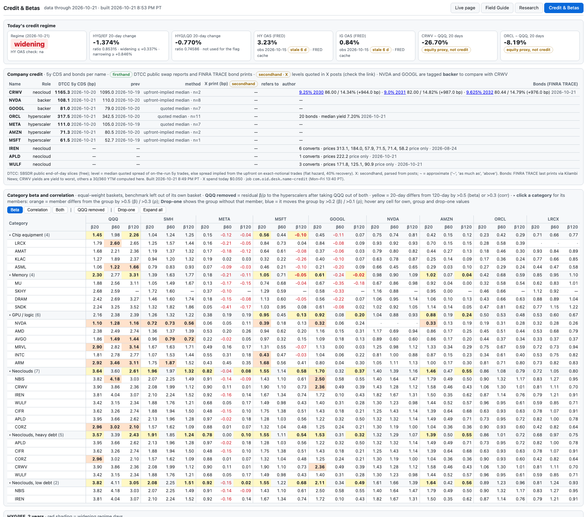

# 36 · Credit & Betas tab
[← Index](README.md)

> Added **Wed 10/21/2026, 8:15 PM PT**; ORCL benchmark and QQQ-removed view added 8:25 PM PT; NVDA benchmark and Company credit section added 8:50 PM PT; per-company rows added 8:55 PM PT. Header button **Credit & Betas**, next to Research. Address: `/credit`. Data endpoint: `/credit.json`. Research only, not an order signal.

**What it is.** A view of the daily credit-spread and category-beta series built by the launchd job `com.oid.desk.spread-corr` (Mon–Fri 13:30 PT, `~/oid-score/research/spread_corr.py`). The page reads `~/oid-data/research/spread-corr/latest.json` and `spread_corr_daily.csv` through `livepage.py`, the same way the other tabs read their files. It shows raw numbers only, with no smoothing.

**Layout, top to bottom**

| Part | What it shows |
|---|---|
| Regime card | Today's flag (**widening**, **flat** or **narrowing**) plus the HY OAS cross-check (agree, partial, disagree or na). |
| HYG/IEF 20-day change | The % change behind the flag, the ratio, and the tercile cutoffs: at or below the lower cut is widening, at or above the upper cut is narrowing. |
| HYG/LQD 20-day change | Shown for context; it does not set the flag. |
| HY OAS, IG OAS | ICE BofA OAS from FRED with the observation date. An amber **stale N d** tag appears when the latest FRED observation is more than 3 days older than the data date. |
| CRWV − QQQ, ORCL − QQQ | 20-day return gap, tagged **equity proxy, not credit**. Real company credit is in the next row. |
| Company credit | Per-name 5y CDS from DTCC public trade reports (firsthand), CDS levels quoted on X (tagged **secondhand**, with author link) and FINRA TRACE bond prices and yields. NVDA and GOOGL are tagged **backer**. See [37](37-company-credit.md). |
| Beta / correlation table | One row per category (chip equipment, memory, GPU/logic, neoclouds, neoclouds with heavy debt, neoclouds with low debt). Columns are β or ρ over 20/60/120 days against QQQ, SMH, META, MSFT, GOOGL, NVDA, AMZN, ORCL and LRCX. The Beta, Correlation and Both buttons switch views. **QQQ removed** switches the table to xβ/xρ against the hyperscalers plus NVDA only (META, MSFT, GOOGL, NVDA, AMZN, ORCL); NVDA is in the set as CRWV's backer (about a 10% stake plus a capacity backstop); the same yellow rule applies. `/credit#x` opens the tab with QQQ removed already on. **Yellow** marks a 20-day value that differs from the 120-day value by more than 0.5 (beta) or 0.3 (correlation); hover to see the gap. Negative values are red. Hover a category to see its members. |
| Per-company rows | Click a category row (▸) or **Expand all** to open one row per member with the same columns: the member's own β/ρ at 20/60/120 days against each benchmark (xβ/xρ when **QQQ removed** is on). **Orange** = the member differs from the group by more than 0.5 (β) or 0.3 (ρ). **Drop-one** switches member rows to the group value recomputed without that member; **blue** = removing it moves the group by more than 0.2 (β) or 0.1 (ρ). Hover any member cell for own, group, own − group, drop-one and the shift. A member that is also the benchmark (e.g. NVDA vs NVDA) shows ·. Open categories are remembered in the browser; `/credit#open` opens all, `#open&drop` opens all in drop-one view. |
| HYG/IEF chart | Two years of the daily ratio, with widening-regime days shaded red. |
| 20-day beta chart | Neocloud and memory 20-day beta to META (solid) and to QQQ (dashed), plus the gold **X** line: neocloud 20-day QQQ-removed beta to META. Widening days are lightly shaded. |
| Footnote | Source, method, file paths and **Last updated**. |

**Method in one paragraph.** Each basket is the equal-weight daily close-to-close return of its members that have data that day; a benchmark is left out of its own basket (equipment vs LRCX is ex-LRCX). β is the rolling OLS slope and ρ the Pearson correlation, and a value needs at least 75% of its window. **QQQ removed** (`<cat>__<hyperscaler>__xbeta{20,60,120}` / `xcorr`): inside each window, the basket's and the hyperscaler's daily returns are each regressed on QQQ, and β/ρ are taken on the two residual series. This shows whether a category follows META, MSFT, GOOGL, NVDA, AMZN or ORCL beyond what the Nasdaq explains. The regime compares the 20-session % change in HYG/IEF with its own trailing 252-session terciles. FRED is optional: when it is unreachable, the job keeps its cache and the desk market tape's latest OAS print.

**Per-company data.** `latest.json` → `members[category][ticker][benchmark]` holds the latest day's `beta20…corr120`, `xbeta*/xcorr*` (hyperscaler benchmarks and NVDA) and `drop_*` (the basket without that ticker, same method). The history is in `spread_corr_tickers_daily.csv`, one row per date/category/ticker/benchmark, appended each run; the wide daily CSV is unchanged.

**Who reads the files.** Research Bot (two-year spread-vs-correlation backtest), Chart Bot and Macro Bot read `spread_corr_daily.csv` / `latest.json` directly instead of rebuilding them. Background: Research Bot's 10/21 finding that the builders' beta to META rises from about 0.40 to 1.28 when spreads widen, while QQQ/SMH beta does not (`research-bot-followup_meta_minute_and_credit-20261021.md` in the same folder).
