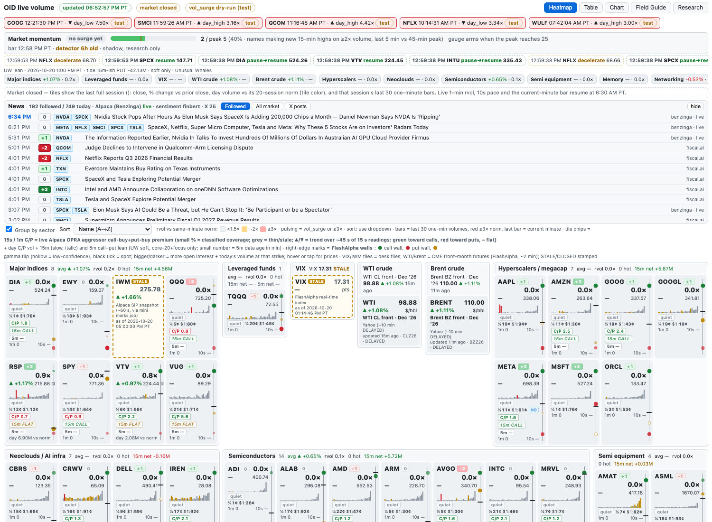
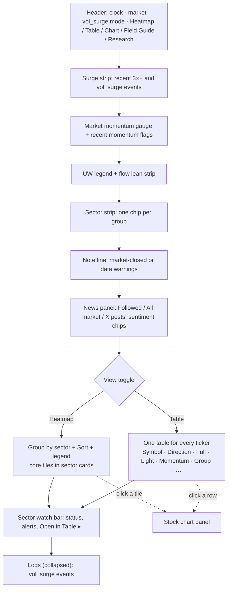
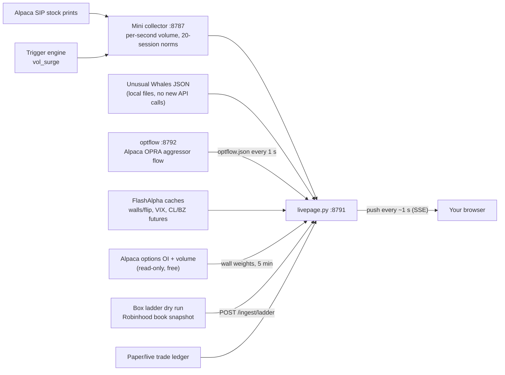

# OID live dashboard: field guide

*Also readable on the live site itself: **Field Guide** tab, https://oid-mini.tail3d8d4d.ts.net/guide/*

The private live dashboard runs on the Mac mini and is only reachable over the tailnet: **https://oid-mini.tail3d8d4d.ts.net/**.
It shows every streamed ticker's volume second by second, the option money leaning into it (live OPRA aggressor flow plus slower Unusual Whales lean), where each name sits against its FlashAlpha call wall, put wall and gamma flip, and what the order book looked like when a surge fired. It also carries VIX, IWM and real CME WTI/Brent futures tiles.

The page is **light mode only**, tiles sit in **sector groups**, and the default sort is **Name (A→Z)**: tiles never float or reorder by themselves.
**It's for research only.** Nothing on this page places orders, and every color on it is soft context, not a trade signal.

## Page map, top to bottom

Current layout (Tue 10/20/2026, 6:55 PM PT):

**Retired panels** (no longer on the page): the Sector watch grid (now Table sections, 10/20 6:30 PM PT), the Last ladder, Live trades and Held option contracts panels (pages 14–16 kept for reference).

## Where the data comes from

## One page per field

| # | Field | Where | One-liner |
|---|---|---|---|
| 1 | [Header & status pills](01-header.md) | top bar | Is the data fresh, is the market open, are surges live or test |
| 2 | [Surge strip](02-surge-strip.md) | under header | The latest 3×+ volume spikes and vol_surge breaks |
| 3 | [Flow lean strip](03-flow-lean-strip.md) | under surge strip | Which way option money is leaning on the busy names |
| 4 | [Tile anatomy](04-tile-anatomy.md) | heatmap | What every number on a tile means |
| 5 | [Price & % change](05-price-change.md) | tile row 2 | Last price and move vs yesterday's close |
| 6 | [rvol & heat color](06-rvol-heat.md) | tile corner and background | Volume vs what's normal for this minute |
| 7 | [Volume bars (sparkline)](07-volume-bars.md) | tile middle | The last 30 minutes of volume, colored by heat |
| 8 | [C/P chip](08-cp-chip.md) | tile chip | Day option call volume ÷ put volume |
| 9 | [15m lean chip](09-lean-chip.md) | tile chip | Last 15 minutes of net call vs put premium |
| 10 | [1-min volume & 10s pace](10-volume-pace.md) | tile bottom | Raw shares and very-short-term speed |
| 11 | [Pulsing border & VS tag](11-hot-vs.md) | tile border | Surge happening now |
| 12 | [Sort dropdown](12-sort.md) | above grid | How to reorder tiles |
| 13 | [Table view](13-table.md) | Table tab | Every ticker as rows; named score columns first: Direction (core v1.1), Full (sector widefull-v1.0), Light (light-v1.0) |
| 14 | [Last ladder panel](14-ladder.md) | **retired** | Order book at the moment of a surge |
| 15 | [Live trades](15-live-trades.md) | **retired** | Trader seats, marks, P&L, exits |
| 16 | [Held option contracts](16-held-options.md) | **retired** | Volume printing in the contracts we hold |
| 17 | [vol_surge events](17-vol-surge-events.md) | Logs (collapsed, bottom) | Log of every surge-and-break event |
| 19 | [Sector groups & source tiles](19-sectors.md) | heatmap / table / strip | Tiles grouped by sector, group summaries, sector strip, editable mapping; VIX, IWM and WTI/Brent CME futures tiles |
| 20 | [5m lean chip](20-lean5-chip.md) | tile chip | Last ~5 min of net call vs put premium (steps with each UW refresh) |
| 21 | [15s / 1m C/P chips (live)](21-live-aggressor-chips.md) | tile chip | Live Alpaca OPRA aggressor call-buy ÷ put-buy premium, ~1 s behind the tape, with ▲/▼ momentum |
| 22 | [C/P momentum spec](22-cp-momentum-spec.md) | tile chip | How the ▲ ▼ – arrow on the 15s/1m chips is computed |
| 23 | [Wall & flip edge marks](23-wall-marks.md) | tile right edge | FlashAlpha call wall / put wall / gamma flip vs spot, sized by OI + today's volume; hover or tap for prices |
| 24 | [Direction score](24-direction-score.md) | badge, table, chart | The three scores, their names and settings versions, inputs, timers, grading |
| 25 | [Momentum](25-momentum.md) | chip, gauge, flags | ACCEL / RESUME / DECEL / quiet |
| 26 | [News panel](26-news.md) | under the strips | Headlines and X posts with −2…+2 sentiment chips |
| 27 | [Timers](27-timers.md) | — | How often every metric updates |
| 28 | [Hal exit watcher](28-hal-exit-watch.md) | background job | Fast stop and target alerts |
| 29 | [How data is saved](29-how-data-is-saved.md) | — | Every archived file, its columns and a real row |
| 30 | [Stock chart](30-chart.md) | Chart button, click a ticker | Candles, volume, score lanes, momentum, C/P, walls |
| 31 | [Score learning plan](31-score-learning-plan.md) | plan | How the scores will learn from logged results (planned) |
| 32 | [Research tab](32-research-tab.md) | Research button | Every study so far, from `studies-index.json` |
| ★ | [Signal walkthroughs](18-walkthroughs.md) | — | Call-lean surge vs put-lean surge vs conflict, with examples |
| ? | [Glossary](glossary.md) | — | Short definitions |

On a phone each sector card takes the full width with 3 tiles across, and the price is hidden to save space ([screenshot](img/page-phone.png)). The wall marks and chips stay; tap the edge scale for the wall tooltip.

## What changed on 10/20/2026 (evening)
| Time (PT) | Change | Page |
|---|---|---|
| 6:05 PM | Chart: future time axis (~2 h), trackpad pan, Center button | [30](30-chart.md) |
| 6:30 PM | One table for every ticker; Sector watch grid retired to a one-line bar; momentum lane on the chart; walls no longer squash candles | [13](13-table.md), [30](30-chart.md) |
| 6:55 PM | Score columns moved next to Symbol and named by profile + settings version; chart lanes and tooltips use the same names; **Research** tab; this guide refreshed with new screenshots | [13](13-table.md), [24](24-direction-score.md), [32](32-research-tab.md) |

## What changed on 10/19/2026
| Time (PT) | Change | Page |
|---|---|---|
| morning | Light mode only (dark theme removed); Name (A→Z) is the default sort and tiles never auto-float | [12](12-sort.md) |
| 11:18 AM | Live 15s / 1m C/P aggressor chips (Alpaca OPRA) | [21](21-live-aggressor-chips.md) |
| 11:42 AM | ▲ ▼ – momentum arrows on those chips | [22](22-cp-momentum-spec.md) |
| late morning | Sector groups with summary headers, sector strip, landscape card layout | [19](19-sectors.md) |
| 12:16 PM | Real CME WTI (CL) and Brent (BZ) futures tiles replace the USO/BNO ETF proxies | [19](19-sectors.md) |
| 2:10 PM | Wall/flip edge marks with hover/tap tooltip | [23](23-wall-marks.md) |
