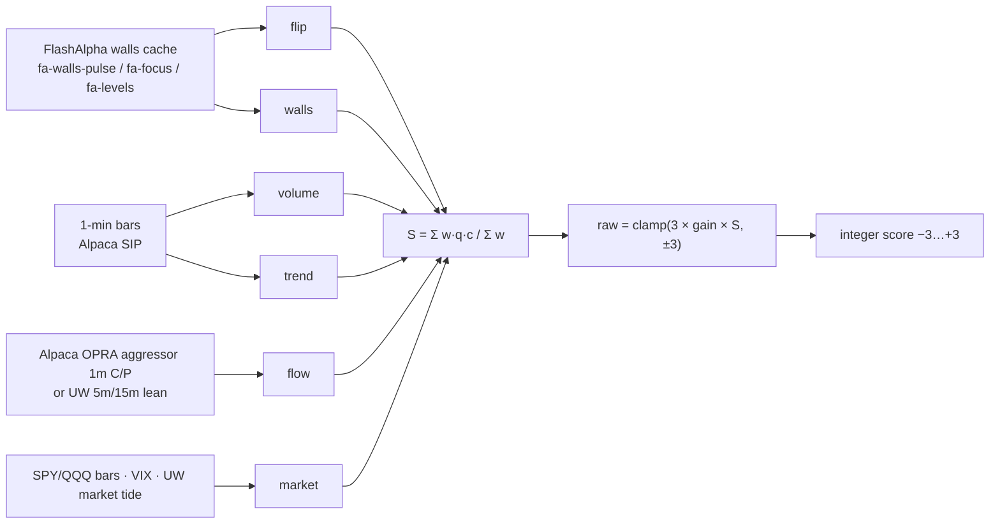

# 24 · Direction score (−3…+3): how it is computed and graded

> **Research and logging only.** The score never places or suggests orders. It is a timestamped guess at the *path of least resistance* that we grade afterwards. Built 10/19/2026. Config `v1-20261019`.

The **badge next to each ticker** (for example <span style="background:#4ac26b;color:#fff;padding:0 4px;border-radius:3px;font-weight:800">+2</span>) is the latest score.

- **+3:** least resistance is upward.
- **−3:** least resistance is downward.
- **0:** mixed or not enough evidence.
- **Colors:** green shades are positive, red shades are negative, grey is 0.
- **Dashed or faded badge:** the score is not a fresh live reading. Either the market is closed, the score is a backfill or the last logged row, or it is more than 5 minutes old.
- **Hover:** shows every input with its value, quality and weight, plus the timestamp and config version.



## 1. The inputs ("components")

Each component produces three numbers:

- **c:** a direction value in [−1, +1].
- **q:** a quality value from 0 to 1. It is 0 when the input is missing and lower when the input is stale or low-confidence.
- **w:** a weight, set in the config.

ATR is the 14-session daily ATR, built from the mini's 1-min history (sessions before today). Using ATR keeps a $30 stock and a $1,600 stock comparable.

| # | Component | Formula for c | Weight | Data source (all already on the mini) | Refresh | Staleness and quality q |
|---|---|---|---|---|---|---|
| 1 | **flip**: price vs gamma flip | `tanh(((px − flip)/ATR) / 0.30)` (above the flip is +, below is −) | 1.00 | Walls cache used by the live page: `data/fa-walls-pulse.json`, `fa-focus-levels.json`, `fa-levels.json`, `fa-flow-levels.json` (newest wins) | NVDA, META and QQQ refresh about every 5 min. Other tickers keep whatever the FA pulses last wrote, so they are often old. | q = 1. Halved when FlashAlpha says the flip is low-confidence (`gf_status ≠ available`, the hollow dot). Halved again when the walls are older than 20 min during market hours. 0 when there is no flip. |
| 2 | **walls**: headroom to the call wall vs the put wall | `up = (callwall − px)/ATR`, `dn = (px − putwall)/ATR`, then `c = (up − dn)/(up + dn)`. If price is already above the call wall, c = +0.30; if below the put wall, c = −0.30. | 0.75 | Same walls cache | Same as flip | Halved when stale (older than 20 min during market hours). 0 when either wall is missing. |
| 3 | **volume**: up/down volume weighted by relative volume | `updn = Σ v·sign(close − prior close) / Σ v` over the last 15 one-min bars; `g = clamp((rvol15 − 0.8)/1.2, 0, 1)`; `c = updn × (0.4 + 0.6·g)` | 0.75 | 1-min bars `cache/bars/store/live/<SYM>-1m-<date>.jsonl`; rvol15 = 15-min volume ÷ the same-minute norms (`live-norms-1m.json`) | Every minute | Halved when the newest closed bar is more than 3 min old. 0 before the first closed bar. |
| 4 | **flow**: options aggressor C/P | Preferred: `clamp(ln(C/P) / ln 3)` using the live page's 1m aggressor chip (call-buy ÷ put-buy premium). Fallback: UW 5m (else 15m) lean, CALL = +0.5, PUT = −0.5. | 0.50 | `~/oid-optflow/data/optflow.json` (Alpaca OPRA) via the live page; UW `uw-net-prem.json` | 1 s for aggressor; about 4 min for UW | Thin or stale aggressor data falls back to UW. UW gets q = 0.5, and is halved again when the 5m value is missing. 0 when there is neither. |
| 5 | **trend**: price vs VWAP plus 15m return | `½·tanh(((px − VWAP)/ATR)/0.15) + ½·tanh(((px − close 15m ago)/ATR)/0.10)` | 1.00 | 1-min bars (session VWAP from bar vwap × volume) | Every minute | Halved when bars are more than 3 min old |
| 6 | **market**: regime | Average of the available parts: **tape** = mean of the SPY and QQQ trend values (formula 5); **VIX** = `−tanh(VIX % change / 5)`; **tide** = `tanh(Δ UW market tide (net call − net put premium) over 30 min / $50M)` | 0.75 | Bars for SPY and QQQ; `vix-live.json` (FlashAlpha index feed already running) vs the prior close from `vix-agent.json` (if dated today, otherwise the first VIX of the session); `uw-market-tide.json` 5-min series | Bars every minute, VIX about 5 min, tide about 4 min | q = (number of parts available) ÷ 3. VIX older than 15 min or tide older than 20 min is dropped from the average. |

Macro is color only. Only the VIX, tape and tide context enter the score.

## 2. From components to −3…+3

```
S     = Σ_enabled ( w · q · c ) / Σ_enabled w           (missing = "shrink": absent or stale inputs pull S toward 0)
raw   = clamp( 3 × gain × S , −3, +3 )                   (gain = 1.5)
score = round-half-away-from-zero(raw)                   (integer −3 … +3)
coverage = Σ w·q / Σ w                                   (how much of the evidence was actually present)
```

- **±3 needs most inputs present, fresh and agreeing.** A ticker without walls (about 40 of the 61) can reach at most about ±2.
- **Alternative missing-input rule:** setting `"missing": "renormalize"` divides by `Σ w·q` instead, so missing inputs don't shrink the score. Use it as a test only (see the ablation workflow below).
- **Every logged row stores:**
  - each component's `x` (the raw measures), `f` (flags: stale, missing, lookahead, source, age), c, q and w;
  - the input timestamps and ages;
  - `stale[]` and `missing[]` lists;
  - `config_version`.

## 3. Worked example: NVDA, Mon 10/19 10:00:00 AM PT (backfill row)

Inputs at that time: px 218.01, ATR 5.75. Flip 217.66 (low-confidence). Call wall 220, put wall 200.

| Component | Measure | c | q | w | w·q·c |
|---|---|---|---|---|---|
| flip | (218.01 − 217.66)/5.75 = +0.061 ATR → tanh(0.061/0.30) | +0.20 | 0.5 (low-confidence flip) | 1.00 | +0.101 |
| walls | up 0.35 ATR to 220, dn 3.13 ATR to 200 → (0.35 − 3.13)/(0.35 + 3.13) | −0.80 | 1.0 | 0.75 | −0.601 |
| volume | updn −0.34, rvol15 0.60 → −0.34 × 0.4 | −0.13 | 1.0 | 0.75 | −0.101 |
| flow | not logged intraday (backfill) | 0 | 0 | 0.50 | 0 |
| trend | +0.09 ATR above VWAP, −0.04 ATR over 15m | +0.07 | 1.0 | 1.00 | +0.066 |
| market | tape −0.68, tide −0.81 (VIX n/a) → mean | −0.74 | 0.667 | 0.75 | −0.372 |

The math:

- Σ w·q·c = **−0.907**, and Σ w = 4.75, so S = −0.191.
- raw = 3 × 1.5 × −0.191 = **−0.86**, so the score is **−1**.
- Coverage is 74%.

What happened next:

- **+5m:** +0.10%, a miss.
- **+30m:** −0.07%, a hit.
- **+1h:** −0.20%, a hit; price touched the flip after 35 min.
- **Close:** −0.40%, a hit.

## 4. When scores are taken (cadence)

| Trigger | When (PT, Mon–Fri, market open only) | Why |
|---|---|---|
| **anchor** | 6:35, 6:45, 7:00, 7:30, 8:30, 10:00, 11:30, 12:30 | Fixed comparison points: the post-open settle (6:35/6:45), the 7:00 ET-10:00 reversal window, 7:30, mid-morning (8:30), the Europe close and lunch lull (10:00, 11:30), and the start of the last half hour (12:30). |
| **grid** | Every 15 min from 6:45 to 12:45 (non-anchor slots) | Even coverage for time-of-day analysis. It costs nothing because it is computed locally. |
| **vol_surge** | When the trigger engine logs a vol_surge (live page surge strip) | Scores the moment we would actually care about. These rows carry the event's level, direction and rvol. |
| badge (not logged) | About every 60 s | Keeps the tile badge current. These rows are not graded. |

Every logged row covers all live-page tickers except VIX, WTI and BRENT (event rows cover only the surging ticker). That is about 1,600 rows a day, roughly 1 MB.

## 5. How a score is graded (outcome tracker)

`score_outcomes.py` runs every 15 min (`com.oid.desk.score-grade`). For each logged row and each horizon (**+5m, +15m, +30m, +1h, +2h, close, next open**), once the window has finished:

- **ret_pct:** the close of the last 1-min bar in the window vs the score-time price.
- **up_pct / dn_pct:** the highest high and lowest low in the window.
- **mfe_pct / mae_pct:** the largest move in the score's direction (favorable) and against it (adverse). Score 0 counts as up.
- **touch:** whether the window's range reached the call wall, put wall or flip, and how many minutes it took to first touch.
- **truncated:** true when the window ran past the 1:00 PM close and was cut there.
- **next_open:** the first 1-min bar's open of the next session.

The report (`score_report.py`) computes, for each horizon:

- **hit:** the share of nonzero scores where the return had the same sign.
- **edge_bps:** the mean of sign(score) × return, in basis points.
- **corr:** the Pearson correlation of raw vs return.
- **Bucket table −3…+3:** n, average return, hit rate, average MFE/MAE, and wall/flip touch rates.
- **Breakdowns:** by ticker, by slot (time of day) and by trigger.

A daily summary is written to `~/oid-data/score/reports/latest-summary.json`.

**Caution:** the 61 tickers scored at the same moment are strongly correlated with each other. One session is effectively a handful of independent observations, so wait for weeks of rows before trusting any bucket.

## 6. Modular inputs and testing accuracy (ablation workflow)

Everything that defines the score lives in **`~/oid-data/config/score-config.json`**:

- `config_version`;
- `components.<name>.enabled`, `.weight` and that component's scale parameters;
- `scale.gain` and `scale.missing`;
- staleness thresholds, cadence and horizons.

The daemon reloads the file automatically when it changes. Every row is stamped with the `config_version` that produced it.

1. **Try a variant without touching live:**
   1. Copy the config to `score-config.<name>.json`.
   2. Change weights, flags or scales, and set a new `config_version`.
   3. Run `cd ~/oid-score && python3 score_report.py --mode all --config ~/oid-data/config/score-config.<name>.json`.

   This re-scores *all logged history* from the stored raw measures (`x`) and flags (`f`), so it does not need new data.
2. **Drop one input at a time:** run `python3 score_report.py --mode all --ablate`. It reports hit / edge / corr for each horizon with each component turned off, plus the change vs the base. A component whose removal *improves* results is a candidate for a lower weight. The grade job writes this every 15 min to `reports/summary-all-all-ablate.json`.
3. **Add an input:**
   1. Add its measure in `score_lib.build_components`, its `c_from_x` formula and a config entry.
   2. Bump `config_version`.

   Older rows simply don't have the input. When you re-score, it counts as missing (q = 0).
4. **Promote a winner:** edit the live config (bump the version). New rows use it from the next slot, and the old rows keep their own stamp.

Caveat on ablation with the "shrink" rule: dropping a component that is *missing* in a row still changes that row's score, because the denominator Σw gets smaller. Use `"missing": "renormalize"` in the test config if you want missing inputs to have no effect.

## 7. Backfill of Mon 10/19 (labeled `mode=backfill`)

`score_backfill.py 2026-10-19` replayed the same schedule (26 slots + 20 vol_surge events, 1,606 rows) from logged 1-min bars. Its limits:

- **Walls and flip:** come from the newest cached snapshot (late morning / 12:45 PM), so earlier rows carry `lookahead: true`.
- **No aggressor/UW flow history and no intraday VIX history:** those inputs are missing, so the scores run smaller.
- **Tide:** uses only points at or before each row's time.

Results go in `reports/summary-all-backfill*.json`. **This is a tiny sample: one session. It is not evidence of an edge.**

## 8. Files and jobs

| What | Where |
|---|---|
| Code | `~/oid-score/` (`score_lib.py`, `score_engine.py`, `score_daemon.py`, `score_outcomes.py`, `score_report.py`, `score_backfill.py`, `score_seed_latest.py`, `score_selftest.py`, `install.sh`) |
| Config | `~/oid-data/config/score-config.json` (live), plus `score-config.*.json` variants |
| Score rows | `~/oid-data/score/scores-YYYYMMDD.jsonl` (append-only); backfill rows in `backfill-scores-YYYYMMDD.jsonl` |
| Outcomes | `~/oid-data/score/outcomes-YYYYMMDD.jsonl` / `backfill-outcomes-…` (append-only, one line per row × horizon) |
| Badge feed | `~/oid-data/score/latest.json` (read by the live page every tick as `row.score`) |
| Reports | `~/oid-data/score/reports/` |
| Jobs | `com.oid.desk.score` (daemon, KeepAlive; idle outside market hours) and `com.oid.desk.score-grade` (every 15 min). Logs are in `~/oid-score/logs/`. |
| Stop | `~/oid-score/install.sh --uninstall` |

The score makes **zero** FlashAlpha, UW or other paid calls of its own. It only reads files that existing jobs already write.
